# NoLimits — Documentación técnica y guía de mantenimiento

> **Proyecto:** No Limits Cyber-Gothic Apparel OS · **Repositorio:** `NotLimit_Proyecto`  
> **Documento para:** integrantes del equipo de desarrollo · **Última revisión del código suministrado:** 22 de noviembre de 2026  
> **Estado:** proyecto en desarrollo; frontend y backend publicados en Vercel y API/catálogo/Google validados manualmente el 22-11-2026. Otros flujos requieren pruebas funcionales y de seguridad.

Este es el documento principal de referencia para instalar, entender, extender y mantener la aplicación. Está basado en los archivos reales de frontend y backend proporcionados por el equipo. Las advertencias sobre seguridad y producción describen puntos específicos detectados en el código, no funcionalidades hipotéticas.

> **Lectura visual:** el README incorpora varios diagramas Mermaid. GitHub los renderiza como diagramas visuales directamente en la página del repositorio, por lo que sirven como imágenes técnicas sin depender de archivos externos.

## Índice de navegación

1. [Objetivo y alcance del sistema](#objetivo-y-alcance-del-sistema)
2. [Estado actual, perfiles y mapa funcional](#estado-actual-perfiles-y-mapa-funcional)
3. [Tecnologías y dependencias](#tecnologías-y-dependencias)
4. [Arquitectura y comunicación entre capas](#arquitectura-y-comunicación-entre-capas)
5. [Estructura del repositorio y responsabilidad de carpetas](#estructura-del-repositorio-y-responsabilidad-de-carpetas)
6. [Instalación local desde cero](#instalación-local-desde-cero)
7. [Variables de entorno, secretos y configuración](#variables-de-entorno-secretos-y-configuración)
8. [Autenticación, Google, cookies y roles](#autenticación-google-cookies-y-roles)
9. [Inicio, identidad visual y experiencia del usuario](#inicio-identidad-visual-y-experiencia-del-usuario)
10. [Catálogo, productos, variantes y stock](#catálogo-productos-variantes-y-stock)
11. [Carrito, checkout, despacho y retiro](#carrito-checkout-despacho-y-retiro)
12. [Webpay Plus: ciclo de vida de pagos](#webpay-plus-ciclo-de-vida-de-pagos)
13. [Cupones, puntos y fidelización](#cupones-puntos-y-fidelización)
14. [Órdenes, historial, estados y comprobantes](#órdenes-historial-estados-y-comprobantes)
15. [Panel administrativo, indicadores y analítica](#panel-administrativo-indicadores-y-analítica)
16. [Administración de sucursales y permisos](#administración-de-sucursales-y-permisos)
17. [Clientes, perfiles, direcciones, favoritos y reseñas](#clientes-perfiles-direcciones-favoritos-y-reseñas)
18. [Devoluciones, incidencias y notificaciones](#devoluciones-incidencias-y-notificaciones)
19. [Editor de página, configuración y contenido](#editor-de-página-configuración-y-contenido)
20. [Clippy IA: asistente animado, asesor de vestuario y gestión segura](#clippy-ia-asistente-animado-asesor-de-vestuario-y-gestión-segura)
21. [Cloudinary y ciclo de vida de medios](#cloudinary-y-ciclo-de-vida-de-medios)
22. [Gmail API, OAuth y correos de bienvenida](#gmail-api-oauth-y-correos-de-bienvenida)
23. [Seguridad y privacidad: controles y pendientes](#seguridad-y-privacidad-controles-y-pendientes)
24. [Despliegue en Vercel: estado y verificación](#despliegue-en-vercel-estado-y-verificación)
25. [Pruebas funcionales y criterios de aceptación](#pruebas-funcionales-y-criterios-de-aceptación)
26. [Diagnóstico de errores frecuentes](#diagnóstico-de-errores-frecuentes)
27. [Guía de colaboración, ramas y commits](#guía-de-colaboración-ramas-y-commits)
28. [Limitaciones conocidas y prioridades de mantenimiento](#limitaciones-conocidas-y-prioridades-de-mantenimiento)
29. [Anexo A: inventario de endpoints del backend](#anexo-a-inventario-de-endpoints-del-backend)
30. [Anexo B: modelos y colecciones MongoDB](#anexo-b-modelos-y-colecciones-mongodb)
31. [Anexo C: scripts y comandos de mantenimiento](#anexo-c-scripts-y-comandos-de-mantenimiento)
32. [Anexo D: guía rápida por archivo y dominio](#anexo-d-guía-rápida-por-archivo-y-dominio)
33. [Glosario y fuentes del repositorio](#glosario-y-fuentes-del-repositorio)

---

## Objetivo y alcance del sistema

NoLimits es una plataforma de comercio electrónico de indumentaria y accesorios con una interfaz inspirada en sistemas operativos clásicos (especialmente Windows XP). No es una aplicación religiosa ni un sistema de gestión de eventos: el README de referencia proporcionado por el equipo se utiliza **solo como ejemplo de profundidad e índice**.

El producto reúne una tienda orientada a clientes y un backoffice para ventas, productos, inventario, sucursales, clientes, proveedores, gastos, reportes, notificaciones, promociones y pedidos. El alcance técnico actual incluye una API Express, persistencia MongoDB, archivos multimedia en Cloudinary, acceso con contraseña o Google y una integración de cobro por Transbank Webpay Plus.

**Criterio de lectura:** este documento diferencia (a) código identificado en los archivos proporcionados, (b) flujo que se desprende del código y (c) funciones que todavía necesitan validación. La presencia de una vista o controlador no equivale a una funcionalidad probada en producción.

---

## Estado actual, perfiles y mapa funcional

### Diagrama ilustrativo: tipos de usuario y alcance funcional

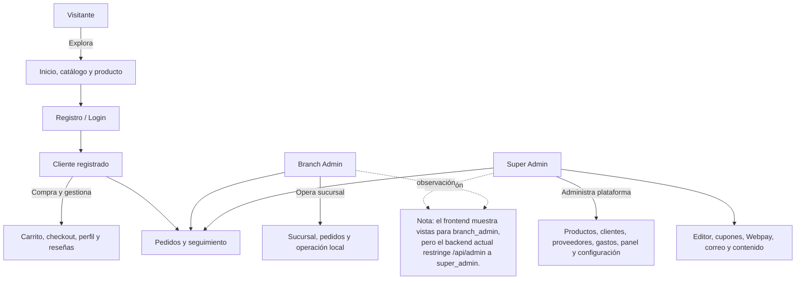


El sistema tiene tres roles principales representados en el modelo de usuarios: `registered` (cliente), `branch_admin` (administración de sucursal) y `super_admin` (administración global). Los visitantes pueden explorar las vistas públicas y el catálogo. Las pantallas administrativas emplean protección de navegación en React.

| Área | Función visible / código | Precaución |
|---|---|---|
| Tienda | Inicio, catálogo, producto, carro, checkout y resultado de pago | Probar pago real y descuento de inventario de extremo a extremo |
| Identidad | Registro, acceso, Google, sesión, edición de perfil | Verificar cookies y orígenes en dominio final |
| Administración | Productos, sucursales, proveedores, clientes, gastos, órdenes, indicadores | El router `/api/admin` exige `super_admin` globalmente |
| Fidelización | Puntos, cupones, catálogo y canje | Validar índices e idempotencia antes de operar con valor real |
| Posventa | Reseñas, devoluciones y comprobantes | Revisar reglas financieras y autorización por ruta |
| Infraestructura | Backend, MongoDB, Cloudinary, correo Google, Webpay | Despliegue Vercel pendiente de verificación práctica |

**Regla de acceso:** nunca interpretar `ProtectedRoute` como medida de seguridad suficiente. El backend debe validar el rol y la propiedad de cada operación.

---

## Tecnologías y dependencias

| Capa | Componentes verificados | Uso |
|---|---|---|
| UI | React 19, React DOM, TypeScript, Vite 8 | SPA y construcción del frontend |
| Estilo | Tailwind CSS 4, CSS modularizado, Lucide React, Motion | Diseño responsivo, iconos y animaciones |
| Navegación | React Router DOM 7 | Rutas públicas y privadas |
| Comunicación | Axios | Instancia centralizada y envío de cookies |
| API | Node.js, Express 4, TypeScript, `tsx` | Controladores, rutas y middleware |
| Base de datos | MongoDB, Mongoose | Modelos, consultas e índices |
| Identidad | bcryptjs, jsonwebtoken, cookie-parser, google-auth-library | Contraseñas, sesión y acceso Google |
| Correo | googleapis (Gmail API) | Envío de correos transaccionales |
| Archivos | Cloudinary, multer, multer-storage-cloudinary | Multimedia y adjuntos |
| Pagos | Webpay Plus/Transbank, cliente HTTP implementado en servicios | Inicialización y conciliación de pagos |
| Protección | express-rate-limit, validaciones y middlewares | Restricción de solicitudes y acceso |

Las versiones concretas deben leerse siempre de `frontend/package.json` y `backend/package.json`; no copiar dependencias entre proyectos sin comprobar compatibilidad.

---

## Arquitectura y comunicación entre capas

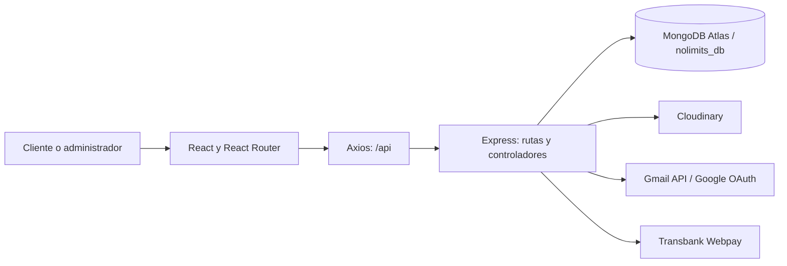

**Frontend:** `frontend/api/axios.ts` crea una instancia con `baseURL = import.meta.env.VITE_API_URL || '/api'` y `withCredentials: true`, necesario para que el navegador envíe la cookie de sesión. Sus interceptores activan y cierran un indicador global de carga; una respuesta 401 genera advertencia, no una redirección automática completa.

**En desarrollo:** `frontend/vite.config.ts` usa un proxy para enviar las solicitudes `/api/*` hacia `http://localhost:5000`, exceptuando el archivo fuente `axios.ts`. Así, el navegador puede usar una ruta relativa mientras Express escucha en otro puerto.

**Backend:** `backend/src/app.ts` compone Express, CORS, parsing de cookies y JSON, rutas bajo `/api` y manejo de errores. `backend/src/server.ts` comprueba longitud mínima del secreto JWT, conecta MongoDB y arranca `app.listen(PORT)`.

**Persistencia:** `backend/src/config/db.ts` conecta a `MONGODB_URI` y selecciona la base de datos `nolimits_db`; después llama a `ensureBaseUsersSeeded()`. En producción la función de provisión automática contiene restricciones: no reintroducir usuarios de demostración.

**Límite actual:** `app.ts` aplica `cors({origin:true,credentials:true})` aunque exista `CORS_ORIGIN` en configuración. Antes de exponer el servicio, restringir orígenes permitidos y revisar conjuntamente cookies, CSRF y protección por ruta.

---

## Estructura del repositorio y responsabilidad de carpetas

```text
NotLimit_Proyecto/
├── backend/
│   ├── scripts/             # Operaciones administrativas y migraciones supervisadas
│   ├── src/
│   │   ├── config/          # MongoDB, Cloudinary, variables y políticas
│   │   ├── controllers/     # Entrada HTTP y respuestas
│   │   ├── middleware/      # Sesión, autorización, errores y origen
│   │   ├── models/          # Esquemas Mongoose y colecciones
│   │   ├── routes/          # Definición de endpoints
│   │   ├── services/        # Lógica de negocio y proveedores externos
│   │   │   └── webpay/      # Cobros, precios, cupones, stock y comprobantes
│   │   ├── utils/           # Criptografía, RUT, contraseñas y tokens
│   │   ├── app.ts           # Configuración de Express
│   │   └── server.ts        # Arranque del proceso HTTP
│   ├── tests/               # Pruebas aportadas
│   └── package.json
├── frontend/
│   ├── api/                 # Axios compartido
│   ├── components/          # Presentación por dominio funcional
│   ├── context/             # Auth, carrito, sucursales, favoritos y alertas
│   ├── routes/              # Rutas, guards y roles
│   ├── services/            # Acceso a API, cálculos y datos auxiliares
│   ├── styles/              # Estilos del sistema retro y matriz responsive
│   ├── types/               # Contratos TypeScript
│   ├── views/               # Vistas públicas y administrativas
│   ├── App.tsx              # Composición principal
│   ├── main.tsx             # Bootstrap React
│   ├── vite.config.ts       # Proxy local y build
│   └── package.json
├── vercel.json              # Configuración propuesta de despliegue
└── .gitignore              # Exclusión de secretos y artefactos
```

**Guía para intervenir:** crear o modificar vistas en `frontend/views`, componentes reutilizables en `frontend/components`, llamadas remotas en `frontend/services` o `frontend/api`, endpoints en `backend/src/routes`, validación HTTP en controladores, lógica compleja en servicios y esquema persistente en modelos. Evitar que una vista modifique directamente datos financieros, puntos o saldo de inventario sin respaldo del servidor.

---

## Instalación local desde cero

**Requisitos:** Git, Node.js compatible con Vite 8 y las dependencias declaradas (verificar versión exacta con el equipo), npm y acceso autorizado a una instancia MongoDB. Las credenciales de Google, Cloudinary o Webpay solo son necesarias para probar sus respectivas integraciones.

```powershell
# Ubicarse en el repositorio clonado
cd NotLimit_Proyecto

# Preparar dependencias del servidor
cd backend
npm install

# Iniciar API (lee backend/src/middleware/.env)
npm run dev
```

En una segunda terminal:

```powershell
cd NotLimit_Proyecto/frontend
npm install
npm run dev
```

La aplicación Vite usa `http://localhost:3000` y Express usa `http://localhost:5000`. El backend expone `GET /api/health` para consultar estado del servicio y un `GET /` que informa conexión a MongoDB (200 si conectado, 503 si no).

**Alternativa de compilación:** desde `backend`, `npm run build` produce el JavaScript con TypeScript; desde `frontend`, `npm run build` produce `dist`. El script `npm start` del backend usa `--env-file=src/middleware/.env`, por lo que **no** debe suponerse que funcionará sin ese archivo en un entorno cloud.

**Si falla la conexión:** confirmar el URI y permisos de red de MongoDB, que el secreto JWT tenga 32 caracteres o más y que los puertos 3000 y 5000 estén libres.

---

## Variables de entorno, secretos y configuración

El código de los archivos entregados muestra la convención `backend/src/middleware/.env` para el proceso local del backend. El archivo `.env` real no fue incluido en los extractos. El frontend puede operar con `'/api'` sin definir una URL alternativa; `VITE_API_URL` es opcional y **no** debe contener secretos.

**Variables observadas en el backend:**

| Variable | Objetivo | Advertencia |
|---|---|---|
| `MONGODB_URI` | Cadena de conexión a MongoDB | Guardar solo en servidor |
| `JWT_SECRET` | Firma y verificación de sesiones | Mínimo 32 caracteres según `server.ts` |
| `PORT` | Puerto Express local | Por defecto 5000 |
| `NODE_ENV` | Modo de ejecución | `production` inhibe provisión demo |
| `CORS_ORIGIN` | Configuración declarada de orígenes | Comprobar uso efectivo en `app.ts` |
| `FRONTEND_URL`, `FRONTEND_URL_PRODUCTION` | Direcciones usadas en redirecciones/correos | Revisar URL final |
| `JWT_EXPIRES_IN`, `AUTH_COOKIE_MAX_AGE_MS` | Caducidad de sesión | Verificar coherencia |
| `GOOGLE_CLIENT_ID` | Validación de Google Sign-In | No exponer secreto OAuth |
| `GMAIL_CLIENT_ID`, `GMAIL_CLIENT_SECRET` | Cliente OAuth del remitente Gmail | Exclusivo backend |
| `GMAIL_REFRESH_TOKEN`, `GMAIL_FROM_EMAIL` | Autorización Gmail y remitente | Exclusivo backend |
| `CLOUDINARY_CLOUD_NAME`, `CLOUDINARY_API_KEY`, `CLOUDINARY_API_SECRET` | Carga/eliminación multimedia | Secret en servidor |
| `WEBPAY_ENV`, `WEBPAY_COMMERCE_CODE`, `WEBPAY_API_KEY` | Ambiente y credenciales Transbank | Nunca enviar al frontend |
| `WEBPAY_BACKEND_URL`, `WEBPAY_FRONTEND_URL`, `WEBPAY_CRON_SECRET` | Retornos, resultado y conciliación | Restringir acceso al cron |

**Reglas:** no versionar `.env`, archivos de credenciales Google ni tokens. `.gitignore` contiene `.env*` con excepción `.env.example`, pero el ejemplo no aparece entre los archivos suministrados. Configurar secretos en Vercel Environment Variables y verificar que los procesos los lean desde `process.env` sin depender de un archivo físico. Evitar guardar valores reales en capturas, logs, README o issues.

---

## Autenticación, Google, cookies y roles

### Diagrama ilustrativo: flujo de autenticación

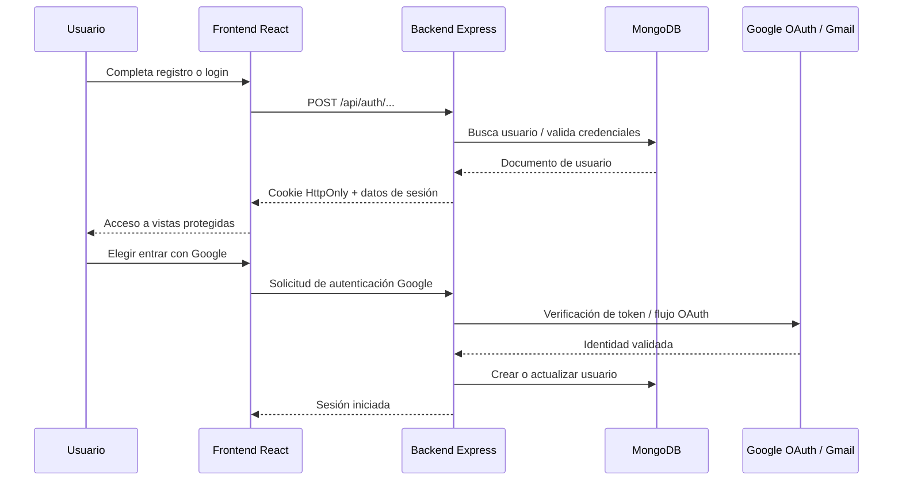


El flujo de identidad está distribuido entre `backend/src/routes/auth.routes.ts`, `controllers/auth.controller.ts`, `services/auth.service.ts`, `middleware/authenticateUser.ts` y `frontend/context/AuthContext.tsx`.

**Contraseña:** el cliente solicita alta/login, el controlador valida la operación, el servicio consulta usuarios Mongoose y compara hash bcrypt. La respuesta de sesión utiliza una cookie HTTP con `withCredentials` del frontend. No asumir que se puede leer dicha cookie desde JavaScript; ese es justamente el propósito de `HttpOnly`.

**Google:** `GET /api/auth/google/config` informa configuración al frontend y `POST /api/auth/google` procesa la autenticación con un token de Google. `frontend/components/auth/GoogleSignInButton.tsx` implementa la entrada visual. Esta integración no es la misma que Gmail: Gmail utiliza credenciales y refresh token para enviar correos desde el backend.

**Sesión:** `GET /api/auth/me` necesita `authenticateUser`; `POST /api/auth/logout` termina el flujo de salida. El contexto React conserva el estado de identidad a nivel UI; el servidor es la autoridad al decidir si una acción está permitida.

**Roles:** `registered` es usuario comprador; `branch_admin` debería quedar limitado a su sucursal; `super_admin` administra operaciones globales. En los extractos, `backend/src/routes/admin.routes.ts` instala `authenticateUser` y `authorizeRoles('super_admin')` para **todas** las rutas siguientes. Por lo tanto, una vista de sucursal permitida en React puede recibir 403 en la API. Es una discrepancia que debe resolverse, no una función concluida.

**Bloqueos y tasa:** política central `loginSecurityPolicy.ts`: 5 intentos de contraseña incorrecta, bloqueo de cuenta durante 15 minutos y limitador IP de 10 solicitudes por 15 minutos. Verificar que estos límites correspondan a la protección real de todas las entradas antes del despliegue.

---

## Inicio, identidad visual y experiencia del usuario

La tienda adopta una estética retro con ventanas, barras, iconos tipo escritorio y componentes inspirados en Windows XP. Los bloques principales están en `frontend/components/home/`: `HeroWelcome`, `FeaturedCatalog`, `ProductCard`, `AdminImageCarousel`, `Bryce3DGallery`, `CosmicBackgroundFx`, `WinampPlayer`, `WindowsMediaPlayerWidget`, `MSPaintPalette` y `MasterStatusBar`.

`frontend/styles/windows-xp.css`, `frontend/styles/responsive-matrix.css`, `frontend/index.css` y las hojas específicas de vista determinan apariencia y diseño adaptable. El diseño no debe comprometer accesibilidad, teclado, contraste, tiempos de carga o funcionamiento en móvil.

El inicio puede incorporar contenido gestionado desde el editor institucional/comercial, imágenes desde Cloudinary, medios y promociones. No asumir que cada elemento visual consulta MongoDB; comprobar en la vista si su estado proviene de un contexto, dato local o petición remota. Los reproductores y efectos de interfaz son **presentación**, no evidencia de un servicio de streaming integrado.

---

## Catálogo, productos, variantes y stock

El catálogo público (`/catalog`) y detalle (`/product/:id`) consultan el endpoint `GET /api/products`. El panel de productos incluye `ProductManagerView`, formulario, tabla, vista previa y carga express. En backend se utilizan `Product.model.ts`, `admin.controller.ts` y rutas administrativas para alta, modificación y eliminación.

Los productos administran título/nombre, identificador, categorías, etiquetas, precios, descuento y fotografías. `normalizeProductPayload` sincroniza `title` y `name`, y `sizeBreakdown`, `sizes` y stock agregado. En edición, `salePrice` se **recalcula en el servidor** desde precio entero CLP y porcentaje de descuento entre 0 y 100.

Los archivos se suben mediante `uploadMiddleware.array('images', 10)` y Cloudinary. La edición conserva URLs indicadas y puede eliminar de Cloudinary fotos retiradas. **Advertencia de mantenimiento:** borrar recursos externos y actualizar MongoDB son operaciones diferentes; revisar consistencia ante errores parciales.

El módulo de stock permite revisar cantidades por talla, inventario y productos agotados. No confundir cambios en `CartContext` o vistas con reservas reales de inventario: confirmar que el flujo de cobro valida y descuenta el stock mediante servicios del backend.

---

## Carrito, checkout, despacho y retiro

### Diagrama ilustrativo: recorrido del cliente en compra

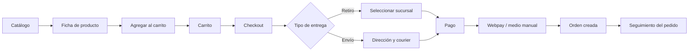


El carro (`frontend/views/CartView.tsx` y `frontend/components/cart/`) presenta artículos, cantidades, resumen, datos del comprador y modalidad de entrega. `CartContext.tsx` mantiene el estado de compra durante la navegación.

El proceso de checkout (`frontend/views/CheckoutView.tsx`) debe construir una solicitud de pago con importes y productos; la cifra que muestra React **no es autoridad financiera**. El backend incluye `services/webpay/pricing.service.ts`, `shippingQuotesEngine.ts` y `stock.service.ts` para evitar confiar en precios manipulados en el navegador.

La logística contempla envío y retiro en sucursal. En la UI existe un modal de horarios; `BranchContext.tsx` modela horarios de retiro editables. `frontend/services/shippingQuotesEngine.ts` y su equivalente backend contienen reglas de cotización. Si se modifican tarifas, actualizar y comparar el cálculo del servidor y su representación en el frontend para evitar diferencias en checkout.

Los transportistas mencionados en la lógica son Starken, Blue Express y Paket. **No afirmar una integración de tracking con API externa** únicamente porque se muestran estos nombres o se admite guardar un código de seguimiento.

---

## Webpay Plus: ciclo de vida de pagos

La integración se organiza en `backend/src/routes/webpay.routes.ts`, `controllers/webpay.controller.ts` y `services/webpay/{webpay.client,paymentLifecycle,pricing,stock,receipt}.service.ts`.

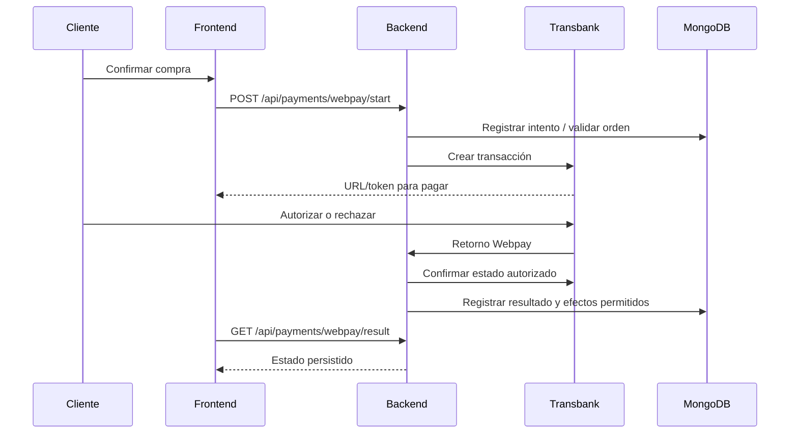

Rutas: `POST /api/payments/webpay/start`, `GET|POST /api/payments/webpay/return`, `GET /api/payments/webpay/result`, `POST /api/payments/webpay/reconcile`. Revisar la autorización de conciliación por cron y las condiciones de idempotencia del servicio antes de tráfico real.

**Principios críticos:** una compra no debe considerarse pagada por mensajes del navegador; la decisión final pertenece a la pasarela y al servidor. Evitar doble descuento de stock, doble acreditación de puntos o confirmaciones duplicadas. No permitir que el panel administrativo simule una confirmación electrónica. El controlador de estado impide cambios de pago Webpay desde el panel ordinario, aunque otros controladores necesitan auditoría conjunta antes de producción.

---

## Cupones, puntos y fidelización

El sistema soporta puntos de fidelización (`loyaltyPoints` en usuario) y canje de cupones persistentes en `payment_coupons`. El catálogo reside en `store_settings.coupons`. Existen `PaymentCoupon.model.ts`, `coupon.controller.ts`, `services/webpay/coupon.service.ts` y `frontend/services/couponsService.ts`.

**Endpoints:** catálogo público `GET /api/payments/coupons/catalog`; billetera `GET /api/payments/coupons/mine` autenticado; canje `POST /api/payments/coupons/redeem` autenticado y limitado; gestión administrativa bajo `/api/admin/coupons`.

**Operación delicada:** los cupones descontados en puntos representan valor económico. `backend/scripts/ensureCouponIndexes.cjs` crea índice único de código y otro índice único parcial sobre `userId + clientRequestId` para idempotencia. Ejecutarlo y verificar conflictos sobre datos existentes **antes** de ofrecer canjes.

`backend/scripts/couponBridge.cjs` ayuda a migrar cupones históricos con modo de simulación por defecto; solo aplica cambios con `--apply --i-reviewed`, valida propietario/código/fechas y bloquea importación en `NODE_ENV=production`. El propio script advierte que un registro de `localStorage` no demuestra que se hayan descontado los puntos. **Nunca importar automáticamente toda una billetera histórica.**

---

## Órdenes, historial, estados y comprobantes

### Diagrama ilustrativo: estados del pedido

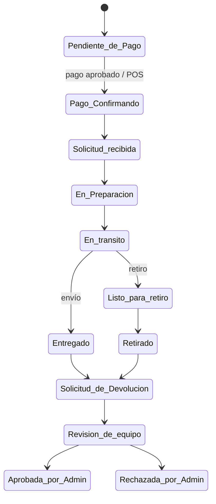


`Order.model.ts` conserva datos de compra, cliente, artículos, montos, método de pago, estado de cobro y de preparación, datos de despacho e historial de cambios. Hay vistas de historial de ventas, órdenes de compra y seguimiento por cliente.

El controlador `updateOrderStatus` restringe saltos de estado (por ejemplo: solicitud recibida → preparación → tránsito → entrega/retiro) y usa un filtro de concurrencia al escribir para evitar pisar un cambio simultáneo. Los cobros electrónicos no se pueden confirmar desde esa ruta de backoffice.

`GET /api/orders/my-orders` requiere login. `GET /api/admin/orders/:id/receipt` ofrece comprobantes a quien tenga permiso administrativo. `receipt.controller.ts`, `receipt.service.ts` y `frontend/services/receiptExport.ts` participan en los comprobantes.

**Revisión pendiente:** el controlador administrativo de creación de ventas POS recibe valores como `paymentStatus` y `total` en `req.body`. Debe auditarse para que solo se acepte una confirmación manual según medio de pago y con cálculo validado en servidor. También debe verificarse que no se descuente stock antes de registrar correctamente una orden válida.

---

## Panel administrativo, indicadores y analítica

### Diagrama ilustrativo: panel y fuentes de datos

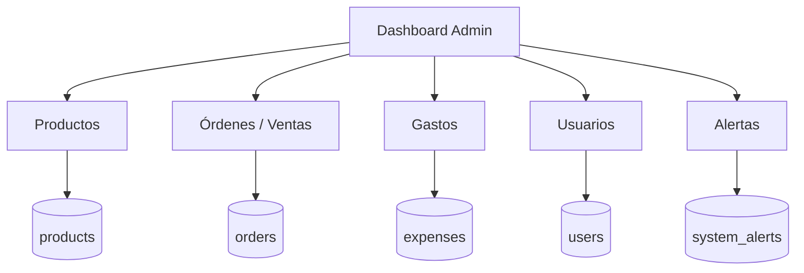


El backoffice se compone de vistas para inventario, resumen de stock, ventas, historial, compras, proveedores, clientes, sucursales, gastos, análisis de ingresos/egresos, logística y top 10. `AdminLayout` y `AdminSidebar` organizan la navegación.

`GET /api/admin/dashboard` usa agregaciones de MongoDB: cuenta productos y usuarios por rol, suma ventas **solo** de órdenes con `paymentStatus: 'CONFIRMED'`, consolida ventas por sucursal y suma gastos operativos. El balance mostrado se obtiene como ingresos confirmados menos gastos almacenados.

**Precisión:** ese balance es un indicador operativo simplificado, no utilidad contable ni conciliación bancaria. Los gráficos del frontend (`IncomeExpensesBarChart`, `RetroPieChart`, etc.) muestran información calculada o entregada por el servicio; revisar siempre el origen del dato antes de incluirlo en informes financieros.

---

## Administración de sucursales y permisos

### Diagrama ilustrativo: operación de sucursales

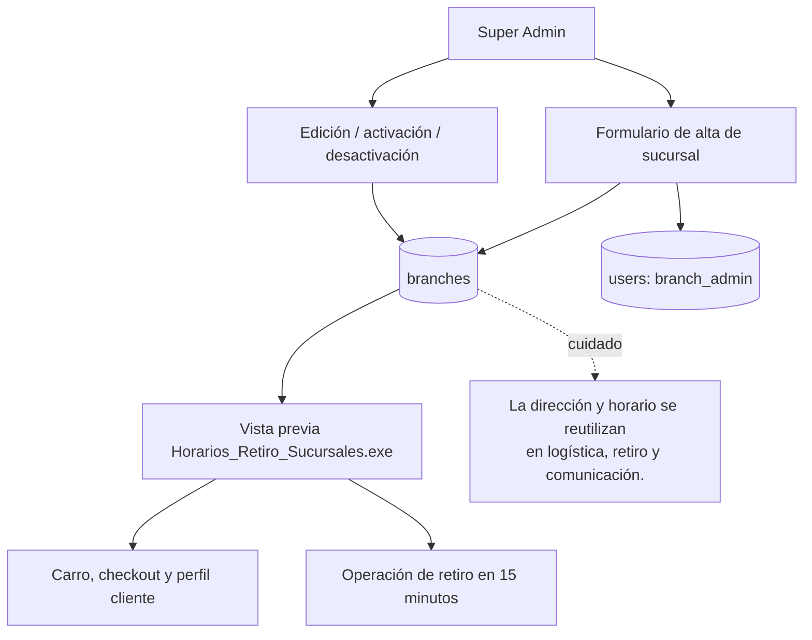


El módulo de sucursales se distribuye entre `BranchManagementView`, `BranchCreateForm`, `BranchListGrid`, `FlexibleScheduleBuilder`, `LiveBranchPreviewCard` y `BranchModals`.

Permite capturar nombre, dirección detallada, comuna, región, responsable, teléfono, credenciales de administrador y bloques de horarios de retiro; modificar horarios con vista previa; editar datos; y confirmar eliminación. La casa matriz se representa como entidad corporativa que el frontend impide eliminar. El controlador Express soporta operaciones CRUD sobre `BranchModel`.

**Diferencia de permisos:** el frontend incluye rutas administrativas para `branch_admin` pero el router backend `admin.routes.ts` exige `super_admin` como middleware global. Esto puede bloquear consultas/acciones de jefes de sucursal. No reducir la seguridad del router global sin diseñar autorización por recurso y filtrado obligatorio por `branchId`.

**Credenciales:** se observa un flujo de creación de cuenta de jefe de sucursal a partir de contraseña recibida por el administrador. Validar política de contraseñas, invitación segura y no exponer hashes/credenciales al listar sucursales.

---

## Clientes, perfiles, direcciones, favoritos y reseñas

La administración de clientes usa `CustomerManagerView` con directorio, edición de datos, puntos e informes/restricciones de clientes. En el servidor, `getCustomers` cruza usuarios `registered` y órdenes para enriquecer estadísticas por ID o email; `createCustomer`, `updateCustomer` y `deleteCustomer` operan sobre MongoDB.

El cliente accede al perfil mediante `/profile`. Sus pestañas de frontend incluyen direcciones, órdenes, puntos, devoluciones, reseñas, ajustes y lista de deseos (`ProfileAddressesTab`, `ProfileOrdersTab`, `ProfilePointsTab`, `ProfileReturnsTab`, `ProfileReviewsTab`, `ProfileSettingsTab`, `ProfileWishlistTab`). Parte del estado se maneja mediante contextos del navegador; comprobar persistencia real caso por caso.

`review.routes.ts` expone reseñas por producto, creación autenticada con imágenes y consultas del propio usuario. El administrador puede consultar, ocultar o eliminar reseñas. Verificar que la creación de una reseña aplique reglas adecuadas sobre compras, identidad y contenido.

---

## Devoluciones, incidencias y notificaciones

El sistema cuenta con `Return.model.ts`, controlador y rutas de devoluciones. El usuario puede crear una solicitud autenticada adjuntando hasta 10 fotografías y consultar sus solicitudes; también existen rutas de revisión administrativa. Las vistas de perfil y backoffice representan estos estados.

Las notificaciones y alertas viven en `SystemAlert.model.ts` y el módulo `InterestNotificationsView`; el backend puede crear alertas asociadas con cobros pendientes y sincronizarlas con órdenes. Hay filtros, indicadores y modales para revisar eventos.

**Riesgo que requiere corrección:** se observan ramas de `updateSystemAlert` que modifican `paymentStatus` al resolver alertas y otra que marca un pago `REJECTED` al rechazar una devolución. La resolución de un reclamo o devolución no debe modificar retroactivamente la evidencia financiera de un cobro confirmado. Antes de operar con pagos reales, separar estados de devolución, reembolso y pago, y auditar la autorización de los endpoints de devoluciones.

---

## Editor de página, configuración y contenido

`PageEditorView` y los componentes de `frontend/components/admin/pageEditor/` administran ajustes del home, banners/sliders, categorías, páginas informativas, medios de portada, fondos, comentarios/reseñas, cupones y tarifas de envío.

La configuración global se guarda en `StoreSettings.model.ts` bajo el documento `global_settings`. El controlador `updateStoreSettings` recibe datos y archivos, actualiza el documento, y puede reemplazar o eliminar archivos multimedia anteriores en Cloudinary. El backend rechaza cambios al campo `coupons` desde la actualización general, para que el catálogo de cupones se gestione por su controlador específico.

Una vista de previsualización no necesariamente constituye una publicación. Al editar piezas compartidas por toda la tienda, comprobar qué lee el frontend al montar la página y si la configuración está persistida en MongoDB.

---

## Clippy IA: asistente animado, asesor de vestuario y gestión segura

> 📎 **Documentación técnica ampliada de Clippy:** [Ver README del módulo, ejemplos de API, archivos y pruebas](docs/clippy/README.md). Incluye capturas de la interfaz y diagramas Mermaid. **La documentación completa está en `docs/clippy/README.md`; este capítulo es la guía rápida.**

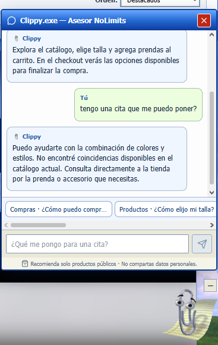

Clippy es el asistente animado de NoLimits, integrado en el escritorio de la tienda con estética Windows XP. Permite responder preguntas frecuentes, acompañar conversaciones sobre ocasión/estilo/paleta y recomendar artículos **reales y visibles** del catálogo. Si no encuentra una prenda apropiada, orienta al cliente para consultar directamente con NoLimits. El widget puede arrastrarse, ocultarse y restaurarse; sus GIF están referenciados en `frontend/clippy/clippy.animations.ts`.

### Flujo de servicio y actores

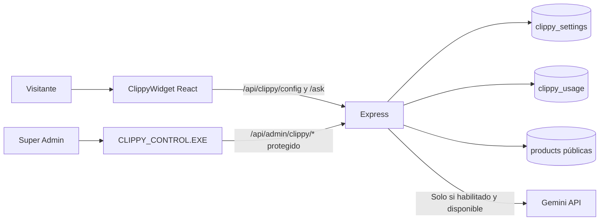

| Característica | Archivo o mecanismo | Comportamiento relevante |
|---|---|---|
| Widget y conversación | `frontend/clippy/ClippyWidget.tsx` | Preguntas libres, FAQ, botones sugeridos y tarjetas de productos |
| Animaciones y diseño | `clippy.animations.ts` + `ClippyWidget.css` | GIF, arrastre, posición persistida y reducción de movimiento |
| Panel del Super Admin | `ClippyAdminView.tsx` + `/#/admin/clippy` | Estado, saludo, personalidad, FAQ, WhatsApp y límites |
| Backend público | `backend/src/clippy/clippy.routes.ts` | `GET /api/clippy/config` y `POST /api/clippy/ask` |
| Backend protegido | `clippyAdminRouter` | `GET/PUT /api/admin/clippy/settings` y `GET /api/admin/clippy/usage` |
| Motor sin IA | `clippy.conversation.ts` | Guía por ocasión → estilo → paleta; evita respuestas secas |
| Gemini | `clippy.gemini.ts` | Usa `GEMINI_API_KEY` **solo** desde Express; fallback al modo guiado |
| Catálogo | `ProductModel` | Máximo cuatro productos visibles y con stock del subconjunto consultado |
| Seguridad | `clippy.security.ts` | Cookies anónimas firmadas, cuotas de uso y validación de consultas |

**Cómo se activa:** colocar `GEMINI_API_KEY` en el entorno del backend, opcionalmente `GEMINI_MODEL=gemini-2.5-flash`, y habilitar **Activar asesoría con Gemini** desde `CLIPPY_CONTROL.EXE` (Super Admin). No es necesario configurar `VITE_API_URL` ni exponer claves al frontend.

**Interfaz simplificada:** la última modificación quitó la casilla de consentimiento del chat. Cuando el administrador habilita la IA, las preguntas libres la utilizan automáticamente dentro de la cuota; las FAQ siguen siendo deterministas. El aviso y tratamiento de datos enviados a Google deben figurar en la documentación de privacidad publicada por la tienda y revisarse conforme a las obligaciones aplicables; eliminar el checkbox no acredita por sí solo una base legal.

**Límites por defecto:** 5 consultas por minuto y 25 por día/visitante, con 200 intentos globales de Gemini al día. Los valores son modificables desde el panel dentro de rangos validados por Express. Las preguntas frecuentes y los ajustes se guardan en `clippy_settings`; los contadores temporales, en `clippy_usage` (TTL). El módulo no guarda conversaciones en MongoDB.

### Pruebas rápidas del módulo

1. Abrir una página pública y comprobar que Clippy se muestra y que `/api/clippy/config` devuelve JSON.
2. Pulsar una FAQ y confirmar respuesta guiada sin consumo de Gemini.
3. Preguntar por una cita y completar estilo/paleta: debe mantener la conversación y recomendar artículos solo cuando existan coincidencias disponibles.
4. Activar Gemini desde Super Admin y probar una consulta libre; verificar `mode=gemini` cuando responda el proveedor.
5. Comprobar que un visitante no pueda acceder a `/api/admin/clippy/settings` y que el backend aplique límites `429`.

**No afecta** los controladores existentes de login, pagos, Webpay, Cloudinary ni inventario. Para ampliar o mantener este módulo, consultar la [documentación íntegra](docs/clippy/README.md) antes de alterar sus contratos.

---

## Cloudinary y ciclo de vida de medios

`backend/src/config/cloudinary.ts` configura cliente Cloudinary y Multer Storage. Clasifica uploads en carpetas: `nolimits_products`, `nolimits_settings`, `nolimits_expenses`, `nolimits_reviews`, `nolimits_returns` y `nolimits_avatars` según la ruta solicitante.

Formatos declarados: JPG, PNG, JPEG, WEBP, GIF, MP4, WEBM y PDF; límites actuales de Multer: 20 MB por archivo y 25 MB para campos de texto/form-data. Estos límites no sustituyen validación de tipo real, autorización, antivirus cuando corresponda y políticas de tamaño por operación.

Al eliminar o reemplazar productos, ajustes o comprobantes, controladores pueden invocar `cloudinary.uploader.destroy()`. Revisar manejo de errores, pertenencia del recurso, fallos parciales y protección contra eliminación de un archivo compartido por otras entidades.

---

## Gmail API, OAuth y correos de bienvenida

El código integra `services/googleMail.service.ts` y las variables Gmail OAuth (`GMAIL_CLIENT_ID`, `GMAIL_CLIENT_SECRET`, `GMAIL_REFRESH_TOKEN`, `GMAIL_FROM_EMAIL`). Se usa para entregar correo transaccional, incluyendo el registro/bienvenida al usuario.

La autorización para **enviar correo** es diferente del botón de **iniciar sesión con Google**. La primera necesita un token de refresco del buzón remitente; la segunda verifica la identidad del cliente. Los tokens del buzón nunca deben estar disponibles en el frontend.

Tras el despliegue, revisar que los enlaces del mensaje apunten al dominio público correcto, que los errores de correo no generen usuarios inconsistentes y que el proyecto tenga políticas adecuadas de cuotas, renovación de credenciales y privacidad.

---

## Seguridad y privacidad: controles y pendientes

**Controles observados:** hashes de contraseña con bcrypt, JWT, cookie de sesión, middleware de autenticación, autorización por roles, validación de origen en determinadas operaciones, rate limiting de login/Webpay/cupones, validación de RUT y validación de algunos parámetros comerciales.

**No prometer seguridad completa:** `cors({origin:true,credentials:true})` permite reflejar orígenes; algunos endpoints sensibles no muestran `validateRequestOrigin`; el route guard React no protege recursos y hay diferencias de alcance entre `branch_admin` y `super_admin`. Revisar todas las escrituras y las operaciones con dinero, clientes, stock, reseñas, archivos, devoluciones y puntos mediante pruebas de autorización.

**Hallazgos concretos para corregir antes de producción:**

1. En `createCustomer` existe una contraseña predeterminada en código si no llega una contraseña. Eliminar el fallback y utilizar un alta con activación/invitación segura.
2. `createOrder` administrativo acepta varios valores financieros del cuerpo HTTP y reconoce banderas de pago confirmado: recalcular y autorizar en backend.
3. `updateSystemAlert` puede alterar estados de pago al gestionar alertas/devoluciones: desacoplar del libro de pagos.
4. Revisar permisos de rutas `/api/returns/admin*` y todas las rutas administrativas por sucursal.
5. Exigir `SameSite`, `Secure`, `HttpOnly`, orígenes confiables y protección CSRF consistente al emplear cookies.
6. Evaluar transacciones/idempotencia para crear órdenes, mover inventario, sumar puntos y aplicar cupones.
7. Verificar ausencia de credenciales en commits antiguos, y rotarlas si alguna vez fueron publicadas.

Para manejo de datos personales (email, RUT, dirección, teléfono, órdenes), documentar finalidad, retención y canales de ejercicio de derechos con asesoría legal aplicable en Chile. La existencia de textos legales en `frontend/components/legal/` no demuestra por sí sola cumplimiento normativo.

---

## Despliegue en Vercel: estado y verificación

### Arquitectura desplegada

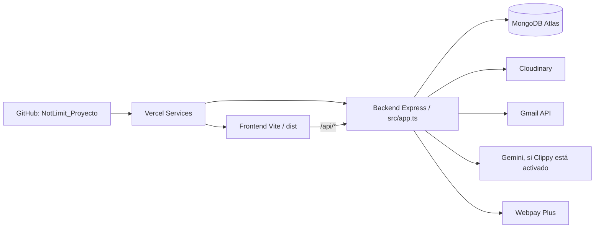

El equipo confirmó manualmente el funcionamiento de la API (`/api/health`), del catálogo que devuelve productos desde Atlas y del acceso Google en `https://notlimitproyecto.vercel.app`. Esto valida esas rutas concretas, **no** supone que todas las integraciones o transacciones financieras estén verificadas en producción.

Para Vercel Services, la configuración de backend utilizada en las correcciones de noviembre de 2026 incluye: `root: "backend/"`, `framework: "express"`, `entrypoint: "src/app.ts"`, `installCommand: "npm ci --legacy-peer-deps --include=dev"`, `buildCommand: "npm run build"` y `outputDirectory: "."`. Este último ajuste permitió superar el error de resolución de `express` durante ejecución. El frontend se publica con Vite (`dist`) y sus peticiones usan `/api` mediante la redirección al servicio backend.

**Checklist de despliegue:** (1) ejecutar `npm run build` en backend y frontend; (2) mantener los secretos en **Environment Variables** de Vercel, no en GitHub; (3) verificar la red autorizada en Atlas y no mantener reglas de acceso excesivamente abiertas sin un análisis de seguridad; (4) revisar los **Runtime Logs** después de desplegar; (5) comprobar `/api/health`, `/api/products`, `/api/store-settings` y `/api/clippy/config`; (6) probar Google, correo de bienvenida, Clippy guiado/Gemini, subidas Cloudinary y Webpay de integración; (7) comprobar políticas de caché y navegación con HashRouter.

**Regla operativa:** `Ready` significa que Vercel terminó el despliegue; no sustituye las pruebas de endpoints. Los casos `Cannot find module 'express'`, `503` por Atlas o `origin_mismatch` de Google se diagnosticaron por separado y deben distinguirse si reaparecen.

---

## Pruebas funcionales y criterios de aceptación

El repositorio incluye `backend/tests/health.test.ts`; no hay evidencia en estos extractos de una batería integral automatizada. Antes de una entrega o publicación, ejecutar al menos:

| Prueba | Resultado esperado |
|---|---|
| Backend `GET /api/health` | JSON 200 y servicio identificable |
| MongoDB | Arranque con conexión válida sin usuarios demo en producción |
| Registro/login/logout | Sesión creada, `me` accesible, sesión invalidada |
| Contraseña incorrecta repetida | Límite/bloqueo según política |
| Google login | Identidad validada en backend y sesión autorizada |
| Roles | Cliente no entra a administración; sucursal solo ve su propio ámbito |
| CRUD productos | Alta, edición, stock, fotos y eliminación coherentes |
| Carro/checkout | Montos calculados en servidor; URL de pasarela válida |
| Webpay aprobado/rechazado | Cambios financieros solo por resultado verificado |
| Reintentos de callback | Sin duplicar orden, stock, puntos ni cupón |
| Devolución/reseña | Solo usuario autorizado puede escribir y consultar su recurso |
| Cloudinary | Upload válido y eliminación segura |
| Gmail | Correo de bienvenida con dominio correcto |
| Responsive | Usabilidad en móvil, tablet y escritorio |
| Vercel | Recursos SPA y `/api/*` responden desde dominio final |

Documentar las evidencias y errores; no marcar «aprobado» sin ejecutar cada caso.

---

## Diagnóstico de errores frecuentes

| Síntoma | Verificar | Acción recomendada |
|---|---|---|
| `ECONNREFUSED localhost:5000` | Proceso Express, puerto, URI y secreto JWT | Ejecutar `npm run dev` en backend y leer consola |
| Vite abre pero API falla | Proxy, `/api`, backend detenido | Revisar DevTools → Network (Fetch/XHR) |
| Login 401 | Cookies, expiración, token, credenciales | Revisar `auth/me` y respuesta sin registrar secretos |
| Login 403 | Rol backend vs frontend | Revisar `admin.routes.ts` y política de sucursal |
| Login 429 o 423 | Rate limit o bloqueo | Revisar política y hora de desbloqueo |
| MongoDB sin registros | URI, dbName `nolimits_db`, respuesta del POST | Confirmar base/colección real y errores del servidor |
| Imagen no carga | API Cloudinary, tipo/tamaño, permisos | Consultar respuesta upload y URL persistida |
| Correo no llega | Gmail OAuth/refresh token/remitente | Revisar errores del servicio Gmail |
| Pago queda pendiente | Retorno Webpay, credenciales, conciliación | Revisar `WebpayAttempt`, orden e idempotencia |
| Vercel 404/500 | Rewrites, build y entrada Express | Corregir configuración y desplegar prueba controlada |

No compartir capturas con tokens de autorización, correos privados, datos de clientes ni credenciales para diagnosticar errores.

---

## Guía de colaboración, ramas y commits

Antes de modificar un módulo, localizar su vista → servicio frontend → ruta backend → controlador → servicio de negocio → modelo. Actualizar contrato TypeScript y verificar cualquier dato derivado de precios, stock o privilegios.

**Flujo recomendado:** crear rama corta de función/corrección, hacer cambios de alcance reducido, compilar frontend y backend, ejecutar pruebas manuales, revisar `git diff`, eliminar logs de debug y secretos, abrir revisión del compañero y fusionar solo cuando pase validación.

Ejemplos de commits: `feat: add stock filter to product manager`, `fix: prevent duplicate webpay confirmation`, `docs: expand NoLimits architecture and setup guide`, `test: cover customer authorization`.

En GitHub Desktop, seleccionar solo los archivos correspondientes, redactar Summary y Description, realizar commit y después Push origin. No usar `git add -f` indiscriminadamente sobre archivos ignorados.

---

## Limitaciones conocidas y prioridades de mantenimiento

**Alta prioridad antes del despliegue:** verificar sintaxis de Vercel y entrada del backend; corregir diferencia entre acceso administrativo de sucursal y API; auditar pagos y alertas; eliminar contraseña predeterminada; revisar CORS/CSRF; aplicar índices para cupones y probar idempotencia.

**Prioridad media:** probar email transaccional en producción, perfeccionar validación de ficheros, robustecer sincronización de imágenes/DB, revisar limpieza de recursos, distinguir datos locales/mock de persistencia real y agregar pruebas automatizadas.

**Prioridad continua:** accesibilidad de interfaz retro, experiencia móvil, observabilidad y alertas, documentación de endpoints y contratos de API, control de cambios de base de datos y política de backups/restauración.

Este README describe el código suministrado (exportación 22-11-2026), no certifica calidad operativa, cumplimiento legal ni seguridad para uso comercial sin auditoría y pruebas.

---

## Anexo A: inventario de endpoints del backend

Las tablas siguientes se generan a partir de las llamadas `router.get/post/put/patch/delete` de los archivos de rutas incluidos. La ruta final incorpora el prefijo montado desde `backend/src/routes/index.ts`. En particular, las rutas de administración están sometidas al middleware global de `super_admin`. Los controles adicionales se deben verificar en cada declaración y controlador.
| Método | Endpoint | Archivo |
|---|---|---|
| `GET` | `/api/clippy/config` | `clippy.routes.ts` (pública) |
| `POST` | `/api/clippy/ask` | `clippy.routes.ts` (pública, limitada) |
| `GET` | `/api/admin/clippy/settings` | `clippy.routes.ts` (Super Admin) |
| `PUT` | `/api/admin/clippy/settings` | `clippy.routes.ts` (Super Admin) |
| `GET` | `/api/admin/clippy/usage` | `clippy.routes.ts` (Super Admin) |
| `GET` | `/api/admin/coupons` | `admin.routes.ts` |
| `GET` | `/api/admin/coupons/redemptions` | `admin.routes.ts` |
| `POST` | `/api/admin/coupons` | `admin.routes.ts` |
| `PUT` | `/api/admin/coupons/:id` | `admin.routes.ts` |
| `PATCH` | `/api/admin/coupons/:id` | `admin.routes.ts` |
| `DELETE` | `/api/admin/coupons/:id` | `admin.routes.ts` |
| `GET` | `/api/admin/dashboard` | `admin.routes.ts` |
| `GET` | `/api/admin/orders` | `admin.routes.ts` |
| `GET` | `/api/admin/orders/:id/receipt` | `admin.routes.ts` |
| `POST` | `/api/admin/orders` | `admin.routes.ts` |
| `GET` | `/api/admin/store-settings` | `admin.routes.ts` |
| `POST` | `/api/admin/products` | `admin.routes.ts` |
| `PUT` | `/api/admin/products/:id` | `admin.routes.ts` |
| `GET` | `/api/admin/products` | `admin.routes.ts` |
| `PUT` | `/api/admin/orders/:id/status` | `admin.routes.ts` |
| `PUT` | `/api/admin/store-settings` | `admin.routes.ts` |
| `DELETE` | `/api/admin/orders/:id` | `admin.routes.ts` |
| `DELETE` | `/api/admin/products/:id` | `admin.routes.ts` |
| `GET` | `/api/admin/suppliers` | `admin.routes.ts` |
| `POST` | `/api/admin/suppliers` | `admin.routes.ts` |
| `PUT` | `/api/admin/suppliers/:id` | `admin.routes.ts` |
| `DELETE` | `/api/admin/suppliers/:id` | `admin.routes.ts` |
| `GET` | `/api/admin/branches` | `admin.routes.ts` |
| `POST` | `/api/admin/branches` | `admin.routes.ts` |
| `PUT` | `/api/admin/branches/:id` | `admin.routes.ts` |
| `DELETE` | `/api/admin/branches/:id` | `admin.routes.ts` |
| `GET` | `/api/admin/expenses` | `admin.routes.ts` |
| `POST` | `/api/admin/expenses` | `admin.routes.ts` |
| `PUT` | `/api/admin/expenses/:id` | `admin.routes.ts` |
| `DELETE` | `/api/admin/expenses/:id` | `admin.routes.ts` |
| `GET` | `/api/admin/customers` | `admin.routes.ts` |
| `POST` | `/api/admin/customers` | `admin.routes.ts` |
| `PUT` | `/api/admin/customers/:id` | `admin.routes.ts` |
| `DELETE` | `/api/admin/customers/:id` | `admin.routes.ts` |
| `GET` | `/api/admin/alerts` | `admin.routes.ts` |
| `POST` | `/api/admin/alerts` | `admin.routes.ts` |
| `PUT` | `/api/admin/alerts/:id` | `admin.routes.ts` |
| `DELETE` | `/api/admin/alerts/:id` | `admin.routes.ts` |
| `GET` | `/api/admin/reviews` | `admin.routes.ts` |
| `PUT` | `/api/admin/reviews/:id/visibility` | `admin.routes.ts` |
| `DELETE` | `/api/admin/reviews/:id` | `admin.routes.ts` |
| `POST` | `/api/auth/login` | `auth.routes.ts` |
| `POST` | `/api/auth/register` | `auth.routes.ts` |
| `GET` | `/api/auth/google/config` | `auth.routes.ts` |
| `POST` | `/api/auth/google` | `auth.routes.ts` |
| `GET` | `/api/auth/me` | `auth.routes.ts` |
| `POST` | `/api/auth/logout` | `auth.routes.ts` |
| `PUT` | `/api/auth/profile/:id` | `auth.routes.ts` |
| `GET` | `/api/returns/my-returns` | `return.routes.ts` |
| `POST` | `/api/returns/` | `return.routes.ts` |
| `GET` | `/api/returns/admin` | `return.routes.ts` |
| `PUT` | `/api/returns/admin/:id/review` | `return.routes.ts` |
| `GET` | `/api/reviews/product/:productId` | `review.routes.ts` |
| `POST` | `/api/reviews/:id/like` | `review.routes.ts` |
| `GET` | `/api/reviews/my-reviews` | `review.routes.ts` |
| `POST` | `/api/reviews/` | `review.routes.ts` |
| `GET` | `/api/system/session-policy/` | `sessionPolicyRoutes.ts` |
| `GET` | `/api/payments/coupons/catalog` | `webpay.routes.ts` |
| `GET` | `/api/payments/coupons/mine` | `webpay.routes.ts` |
| `POST` | `/api/payments/coupons/redeem` | `webpay.routes.ts` |
| `POST` | `/api/payments/webpay/start` | `webpay.routes.ts` |
| `GET` | `/api/payments/webpay/return` | `webpay.routes.ts` |
| `POST` | `/api/payments/webpay/return` | `webpay.routes.ts` |
| `GET` | `/api/payments/webpay/result` | `webpay.routes.ts` |
| `POST` | `/api/payments/webpay/reconcile` | `webpay.routes.ts` |

---

## Anexo B: modelos y colecciones MongoDB

Estos modelos Mongoose aparecen en `backend/src/models`. Los nombres de colección efectivos pueden depender del argumento de `mongoose.model` o de su opción `collection`; consultar cada esquema antes de escribir scripts directos en MongoDB. Los modelos son el contrato de persistencia: al cambiar un campo, revisar su uso en controladores, formularios y reportes.

| Modelo fuente | Finalidad principal |
|---|---|
| `User.model.ts` | Identidad, roles, perfil, puntos, estadísticas |
| `Branch.model.ts` | Sucursales, responsables y horarios |
| `Product.model.ts` | Catálogo, precios, tallas y stock |
| `Order.model.ts` | Pedidos, cobros, logística e historial |
| `WebpayAttempt.model.ts` | Intentos y estado de transacciones Webpay |
| `PaymentCoupon.model.ts` | Cupones canjeados y estado de uso |
| `StoreSettings.model.ts` | Configuración global y catálogo promocional |
| `Supplier.model.ts` | Registro de proveedores |
| `Expense.model.ts` | Gastos y adjuntos |
| `Review.model.ts` | Opiniones de productos |
| `Return.model.ts` | Solicitudes de devolución |
| `SystemAlert.model.ts` | Alertas y tareas administrativas |
| `backend/src/clippy/clippy.model.ts` | `clippy_settings` (configuración) y `clippy_usage` (contadores TTL) |

**Atención:** `backend/scripts/seed.ts` es actualmente un *stub*: imprime un mensaje y no crea efectivamente nueve colecciones. No anunciar que el seed ya pobló datos.

---

## Anexo C: scripts y comandos de mantenimiento

| Comando ejecutado desde su directorio | Qué hace |
|---|---|
| `cd backend && npm run dev` | Arranca Express en modo observación |
| `cd backend && npm run build` | Compila TypeScript con `tsc` |
| `cd backend && npm start` | Ejecuta `dist/server.js` con `.env` local |
| `cd frontend && npm run dev` | Arranca Vite en puerto 3000 |
| `cd frontend && npm run build` | Genera `dist` para producción |
| `cd frontend && npm run lint` | Ejecuta `tsc --noEmit` (revisión de tipos) |
| `cd backend && node --env-file=src/middleware/.env scripts/ensureCouponIndexes.cjs` | Crea/verifica índices de cupones |
| `cd backend && node --env-file=src/middleware/.env scripts/couponBridge.cjs status` | Consulta estado de catálogo y cupones |
| `cd backend && node --env-file=src/middleware/.env scripts/couponBridge.cjs catalog --file RUTA.json` | Simula validación de catálogo; no aplica cambios |

El comando `couponBridge` para aplicar cambios requiere además `--apply --i-reviewed`, y está restringido. No ejecutarlo sobre datos reales sin respaldo y revisión conjunta. El script `seed.ts` no constituye un seeding completo.

---

## Anexo D: guía rápida por archivo y dominio

Este índice técnico permite encontrar el código más rápidamente. Los nombres reflejan los archivos disponibles en los TXT; la lista no sustituye el repositorio Git real. Para investigar un bug, buscar primero la vista, después el servicio usado y finalmente el controlador y modelo correspondientes.

<details>
<summary>Ver archivos clave (rutas relativas)</summary>

```text
backend/src/controllers/admin.controller.ts
backend/src/controllers/auth.controller.ts
backend/src/controllers/coupon.controller.ts
backend/src/controllers/health.controller.ts
backend/src/controllers/receipt.controller.ts
backend/src/controllers/return.controller.ts
backend/src/controllers/review.controller.ts
backend/src/controllers/webpay.controller.ts
backend/src/middleware/auth.middleware.ts
backend/src/middleware/authenticateUser.ts
backend/src/middleware/authorizeRoles.ts
backend/src/middleware/authorizeSucursal.ts
backend/src/middleware/errorHandler.ts
backend/src/middleware/validateRequestOrigin.ts
backend/src/models/Branch.model.ts
backend/src/models/Expense.model.ts
backend/src/models/Order.model.ts
backend/src/models/PaymentCoupon.model.ts
backend/src/models/Product.model.ts
backend/src/models/Return.model.ts
backend/src/models/Review.model.ts
backend/src/models/StoreSettings.model.ts
backend/src/models/Supplier.model.ts
backend/src/models/SystemAlert.model.ts
backend/src/models/User.model.ts
backend/src/models/WebpayAttempt.model.ts
backend/src/models/index.ts
backend/src/services/auth.service.ts
backend/src/services/googleMail.service.ts
backend/src/services/index.ts
backend/src/services/webpay/coupon.service.ts
backend/src/services/webpay/paymentLifecycle.service.ts
backend/src/services/webpay/pricing.service.ts
backend/src/services/webpay/receipt.service.ts
backend/src/services/webpay/shippingQuotesEngine.ts
backend/src/services/webpay/stock.service.ts
backend/src/services/webpay/webpay.client.ts
frontend/context/AdminNotificationContext.tsx
frontend/context/AuthContext.tsx
frontend/context/BranchContext.tsx
frontend/context/CartContext.tsx
frontend/context/WishlistContext.tsx
frontend/services/api.ts
frontend/services/couponsService.ts
frontend/services/mockData.ts
frontend/services/productPresentation.ts
frontend/services/productStock.ts
frontend/services/receiptExport.ts
frontend/services/shippingQuotesEngine.ts
frontend/views/AuthView.tsx
frontend/views/CartView.tsx
frontend/views/CatalogView.tsx
frontend/views/CheckoutView.tsx
frontend/views/HomeView.css
frontend/views/HomeView.tsx
frontend/views/ProductDetailView.tsx
frontend/views/ProfileView.tsx
frontend/views/WebpayResultView.tsx
frontend/views/admin/AdminLayout.tsx
frontend/views/admin/BranchManagementView.tsx
frontend/views/admin/CustomerManagerView.tsx
frontend/views/admin/ExpressProductUploadView.tsx
frontend/views/admin/GlobalDashboardView.tsx
frontend/views/admin/IncomeExpensesAnalyticsView.tsx
frontend/views/admin/InterestNotificationsView.tsx
frontend/views/admin/InventoryManagementView.tsx
frontend/views/admin/LocalBranchAdminView.tsx
frontend/views/admin/LogisticsAnalyticsView.tsx
frontend/views/admin/PageEditorView.tsx
frontend/views/admin/ProductManagerView.tsx
frontend/views/admin/ProductStockSummaryView.tsx
frontend/views/admin/PurchaseOrdersManagementView.tsx
frontend/views/admin/RegisterExpenseView.tsx
frontend/views/admin/RegisterSaleView.tsx
frontend/views/admin/SalesHistoryView.tsx
frontend/views/admin/SupplierManagementView.tsx
frontend/views/admin/Top10AnalyticsView.tsx
```
</details>

---

## Glosario y fuentes del repositorio

**API REST:** interfaz HTTP entre React y Express. **JWT:** token firmado para acreditar sesión. **Cookie HttpOnly:** cookie que JavaScript no puede leer directamente. **CORS:** reglas de acceso entre orígenes. **CSRF:** ataque que intenta ejecutar una operación autenticada desde otro sitio. **Mongoose:** ODM de MongoDB. **SPA:** aplicación cuyo enrutamiento ocurre principalmente en navegador. **Idempotencia:** propiedad de una operación para no generar efectos duplicados al reintentarse. **Webhook/retorno de pago:** comunicación de resultado de una pasarela, que debe verificarse en el servidor.

**Fuentes primarias utilizadas:** `backend_context(4).txt` (64 archivos), `frontend_context(4).txt` (181 archivos), los parches verificados de Clippy y las capturas de prueba proporcionadas el 22-11-2026. El módulo Clippy está documentado extensamente en [`docs/clippy/README.md`](docs/clippy/README.md). Los archivos de exportación omiten `.env`, documentación preexistente y medios; por tanto, los valores reales de credenciales, contratos privados y estado de Vercel no pueden deducirse de ellos.

**Política para mantener este README:** cada cambio relevante en rutas, variables, permisos, modelo de datos o despliegue debe reflejarse aquí en el mismo pull request. Actualizar la fecha de revisión y señalar los escenarios aún no probados.

---

