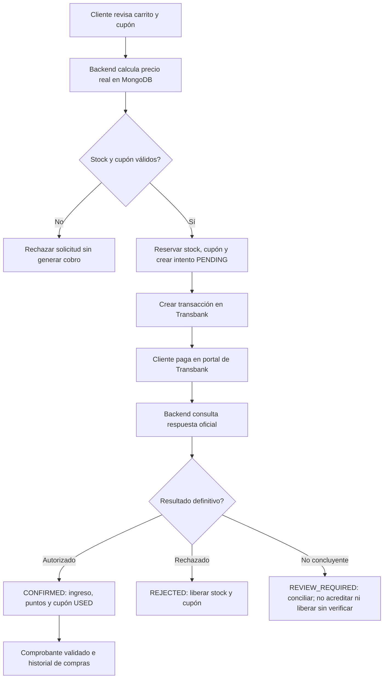

# 01 · Integración Webpay Plus (Transbank)

**Proyecto:** NoLimits / NotLimit_Proyecto  
**Corte:** 21-11-2026  
**Modo de operación documentado:** integración de pruebas; el paso a producción requiere revisión y credenciales propias.

## 1. Objetivo

Permitir que un cliente compre prendas con Webpay Plus y, si corresponde, aplique **un cupón que ya canjeó con puntos**. El sistema debe proteger el inventario frente a compras simultáneas, confirmar el ingreso **solo cuando Transbank autorice el pago**, evitar dobles confirmaciones y liberar stock y cupón al verificarse un rechazo definitivo.

Los **puntos no son dinero para descontar en el checkout**: se usan en el canje de un cupón emitido y validado por MongoDB.

## 2. Arquitectura y archivos

| Responsabilidad | Archivo principal |
|---|---|
| Entrada HTTP y callbacks | [`../src/routes/webpay.routes.ts`](../src/routes/webpay.routes.ts) |
| Orquestación de compra, retorno y consultas | [`../src/controllers/webpay.controller.ts`](../src/controllers/webpay.controller.ts) |
| Cliente REST Transbank | [`../src/services/webpay/webpay.client.ts`](../src/services/webpay/webpay.client.ts) |
| Precio vigente calculado en servidor | [`../src/services/webpay/pricing.service.ts`](../src/services/webpay/pricing.service.ts) |
| Reserva y liberación de unidades/talla | [`../src/services/webpay/stock.service.ts`](../src/services/webpay/stock.service.ts) |
| Canjes, validación, reserva y consumo de cupones | [`../src/services/webpay/coupon.service.ts`](../src/services/webpay/coupon.service.ts) |
| Confirmación/rechazo y datos contables | [`../src/services/webpay/paymentLifecycle.service.ts`](../src/services/webpay/paymentLifecycle.service.ts) |
| Comprobante basado en orden persistida | [`../src/services/webpay/receipt.service.ts`](../src/services/webpay/receipt.service.ts) |
| Orden, intento y cupón emitido | `../src/models/Order.model.ts`, `WebpayAttempt.model.ts`, `PaymentCoupon.model.ts` |
| Vista del pago y comprobante del cliente | `frontend/views/WebpayResultView.tsx`, `frontend/components/common/PurchaseReceipt.tsx` |

## 3. Flujo explicado

1. **Inicio:** `POST /api/payments/webpay/start`. El backend exige un `requestId` con formato válido e impide repetir la misma solicitud. El precio se calcula consultando `products` y el envío se calcula en el servidor. Los importes enviados desde el navegador no se tratan como fuente de verdad.
2. **Cupón opcional:** se identifica al propietario mediante su sesión válida; se consulta `payment_coupons`, se valida propietario, estado `AVAILABLE`, vencimiento y mínimo de compra. Se reserva como `RESERVED`, asociado a la orden.
3. **Reserva:** en una transacción MongoDB, el stock disponible baja de forma condicional por producto/talla, se crea `orders` con `paymentStatus: PENDING` e ingreso confirmado `0`, y se crea `webpay_attempts` en `INITIATING`.
4. **Solicitud externa:** fuera de la transacción MongoDB, el backend crea la transacción en Transbank. Un intento preparado pasa a `READY`. La página de pago es la URL oficial devuelta por Transbank.
5. **Retorno:** `GET/POST /api/payments/webpay/return`. El backend envía el token a la API de Transbank para confirmarlo (`commit`) y valida `status`, `response_code`, monto, orden y sesión.
6. **Confirmación:** si los datos coinciden, una transacción MongoDB marca `orders.paymentStatus = CONFIRMED`, `webpay_attempts.state = CONFIRMED`, fija `confirmedRevenue = total`, incrementa `soldUnits`, actualiza estadísticas/puntos del usuario y consume el cupón reservado como `USED`. El stock **no vuelve a descontarse**, porque ya quedó reservado.
7. **Rechazo definitivo:** se marca `REJECTED`, se restituyen las unidades reservadas, se libera el cupón y `confirmedRevenue` queda en `0`.
8. **Respuesta incierta:** un timeout o callback de abandono **no debe interpretarse como rechazo**. El intento puede pasar a `REVIEW_REQUIRED` y requiere conciliación antes de tocar el inventario.
9. **Consulta y comprobante:** `GET /api/payments/webpay/result` requiere `order` y una clave temporal de consulta; solo se entrega comprobante verificado cuando coinciden el intento `CONFIRMED` y la orden `CONFIRMED`.

> La clave temporal se guarda en `sessionStorage` durante este flujo, **no** es una autorización para pagar ni la fuente del estado de la compra. El carrito puede persistirse localmente, pero el precio, estado y cupón real se validan en el backend.

## 4. Estados persistidos

| Ubicación | Estados | Significado |
|---|---|---|
| `orders.paymentStatus` | `PENDING`, `CONFIRMED`, `REJECTED`, `REFUNDED` | Situación económica de la orden. |
| `webpay_attempts.state` | `INITIATING`, `READY`, `VERIFYING`, `CONFIRMED`, `REJECTED`, `REVIEW_REQUIRED` | Estado técnico de la operación con Transbank. |
| `payment_coupons.status` | `AVAILABLE`, `RESERVED`, `USED` | Disponibilidad del código emitido. |
| `orders.fulfillmentStatus` | `Solicitud recibida`, `En Preparación`, etc. | Preparación, envío o retiro; **no prueba el pago**. |

La regla principal es **no confundir `paymentStatus` con `fulfillmentStatus`**. El administrador puede gestionar preparación y entrega de órdenes confirmadas, pero no aprobar por su cuenta pagos Webpay.

## 5. Datos en MongoDB

- `products`: catálogo, precio base, descuentos vigentes y stock por talla.
- `orders`: snapshot de los artículos, cantidades, montos, pago, entrega y auditoría de cambios.
- `webpay_attempts`: token de intento, identificadores, estado técnico y fecha objetivo de conciliación.
- `store_settings` → `global_settings.coupons`: **plantillas administradas** de cupones, costo en puntos y condiciones.
- `payment_coupons`: **cupones individuales emitidos** a una cuenta, estado, vencimiento y orden que los utilizó.
- `users`: puntos acumulados y estadísticas de compras.

Por eso `store_settings.coupons` y `payment_coupons` no son duplicados: uno define la oferta; el otro registra los códigos individuales canjeados.

## 6. Rutas relevantes

| Método y ruta | Propósito | Controles presentes en código |
|---|---|---|
| `POST /api/payments/webpay/start` | Crear intento de pago | Límite de solicitudes, validación de origen, idempotencia por requestId, cálculo de servidor. |
| `GET/POST /api/payments/webpay/return` | Retorno Transbank | Consulta/verificación con API de Transbank y control del estado del intento. |
| `GET /api/payments/webpay/result` | Consultar orden y comprobante | Clave temporal de consulta + doble comprobación de confirmación. |
| `POST /api/payments/webpay/reconcile` | Conciliación administrativa/programada | Cabecera `X-NoLimits-Cron-Secret`. |
| `GET /api/payments/coupons/catalog` | Plantillas activas | Datos provenientes de MongoDB. |
| `GET /api/payments/coupons/mine` | Cupones de la cuenta | Requiere autenticación. |
| `POST /api/payments/coupons/redeem` | Canje por puntos | Sesión, rate limit, origen, débito y emisión transaccional. |
| `GET /api/admin/orders/:id/receipt` | Comprobante de la orden | Router administrativo autenticado y limitado a superadministrador. |

## 7. Variables de entorno — solo backend

Archivo local **no versionado**: `backend/src/middleware/.env`.

| Variable | Uso |
|---|---|
| `MONGODB_URI` | Conexión a MongoDB. |
| `JWT_SECRET` | Firma de la sesión. |
| `WEBPAY_ENV` | `integration` o `production`. |
| `WEBPAY_COMMERCE_CODE` | Código de comercio provisto por Transbank. |
| `WEBPAY_API_KEY` | Credencial privada de la API. |
| `WEBPAY_BACKEND_URL` | URL pública del backend, sin `/api` final. |
| `WEBPAY_FRONTEND_URL` | URL pública del frontend. |
| `WEBPAY_CRON_SECRET` | Autoriza la conciliación programada. |
| `FRONTEND_URL` / `FRONTEND_URL_PRODUCTION` | Orígenes permitidos para operaciones protegidas. |

El frontend se conecta a la API mediante Axios (`frontend/api/axios.ts`) y la variable de conexión definida por el proyecto. **Nunca enviar `WEBPAY_API_KEY` ni credenciales MongoDB al frontend ni a GitHub.** Para producción el código exige HTTPS en las URLs Webpay.

## 8. Seguridad observada en código

- **Separación de responsabilidades:** el backend calcula montos; la interfaz solo presenta y solicita.
- **Stock protegido:** actualización condicional por unidades/talla dentro de transacción MongoDB.
- **Idempotencia:** identificador `requestId` único en intentos y canjes; transiciones de pago condicionadas por estado.
- **Canje ligado a usuario:** comprobación de propiedad y puntos en base de datos; no se confía en objetos alterados en `localStorage`.
- **Validación Transbank:** identificación de orden, sesión, monto, resultado y código de respuesta.
- **Comprobante controlado:** no se trata una captura del navegador como prueba de pago.
- **Protección HTTP:** control de origen y limitador de solicitudes en operaciones sensibles.

Estos son **controles implementados**, no evidencia de pruebas de penetración completas. Ver [pruebas](02_PRUEBAS_Y_VALIDACION.md) y [riesgos](03_REGISTRO_DE_ERRORES.md).

## 9. Advertencias operativas

1. **Conciliación:** el endpoint existe, pero el TXT no evidencia un scheduler realmente activo que lo invoque en producción. Si un intento queda incierto, el stock puede continuar reservado hasta conciliación. No asumir liberación automática por tiempo transcurrido.
2. **Intentos sin token:** la conciliación devuelve `MANUAL_REVIEW_NO_TOKEN`; el procedimiento de recuperación necesita definirse y probarse.
3. **No eliminar órdenes con pago confirmado:** preservar trazabilidad y comprobantes. Las devoluciones requieren un proceso separado de la confirmación del cobro.
4. **Antes de producción:** ejecutar matriz de concurrencia, caída de red, reintentos, conciliación e idempotencia con entorno de integración; revisar riesgos abiertos.
