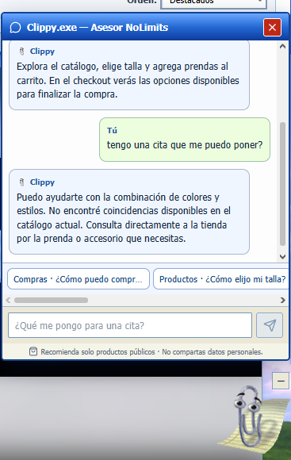
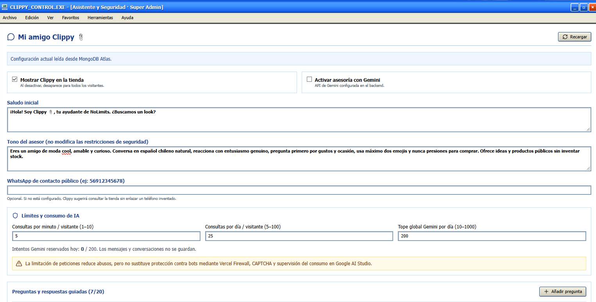
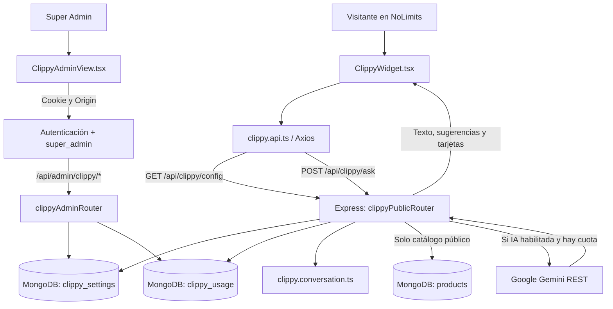
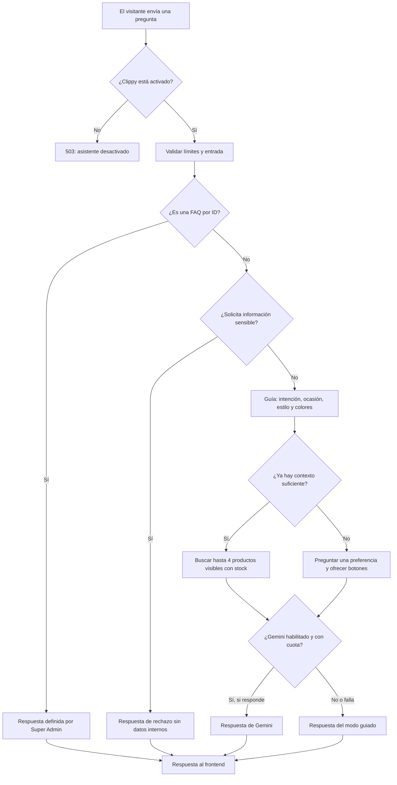

# 📎 Clippy IA — Asistente de vestuario de NoLimits

> **Proyecto:** NoLimits Cyber-Gothic Apparel OS  
> **Tipo de módulo:** Asistente público conversacional + asesor de vestuario + consola Super Admin  
> **Tecnologías:** React 19 · TypeScript · Express · MongoDB Atlas/Mongoose · Google Gemini REST · CSS  
> **Última revisión de esta integración:** 22 de noviembre de 2026  
> **Estado:** integrado y probado visualmente por el equipo en entorno local; el funcionamiento en producción, los límites y la facturación de Gemini deben verificarse tras cada despliegue.

Clippy es el pequeño asistente animado de NoLimits. Acompaña a quienes visitan la tienda, responde preguntas frecuentes, conversa sobre estilo y **recomienda productos reales del catálogo público** cuando corresponde. Su diseño retoma la estética retro de Windows XP presente en el resto de la tienda. La administración se concentra en una pantalla reservada al rol `super_admin`.

**Regla de arquitectura:** el navegador **nunca** recibe `GEMINI_API_KEY` ni se conecta directamente a Gemini o a las colecciones administrativas. Toda consulta sale desde React hacia la API Express de NoLimits (`/api/clippy/*`).



<details><summary>Ver panel administrativo</summary>



</details>

> Las imágenes anteriores son capturas de desarrollo. Los GIF animados del personaje se cargan desde Tenor; revisar derechos de terceros antes de utilizarlos comercialmente.

---

## Índice

1. [Objetivo y alcance](#1-objetivo-y-alcance)
2. [Funciones del visitante y del administrador](#2-funciones-del-visitante-y-del-administrador)
3. [Diagrama de arquitectura](#3-diagrama-de-arquitectura)
4. [Flujo de una conversación](#4-flujo-de-una-conversación)
5. [Estructura de archivos](#5-estructura-de-archivos)
6. [Cómo se integra con la aplicación existente](#6-cómo-se-integra-con-la-aplicación-existente)
7. [Interfaz y animaciones de Clippy](#7-interfaz-y-animaciones-de-clippy)
8. [Preguntas frecuentes y modo guiado](#8-preguntas-frecuentes-y-modo-guiado)
9. [Asesoría de moda con Google Gemini](#9-asesoría-de-moda-con-google-gemini)
10. [Cómo se buscan y recomiendan productos](#10-cómo-se-buscan-y-recomiendan-productos)
11. [Consola Super Admin](#11-consola-super-admin)
12. [Rutas REST y contratos](#12-rutas-rest-y-contratos)
13. [Modelos y colecciones de MongoDB](#13-modelos-y-colecciones-de-mongodb)
14. [Límites de consumo y controles de seguridad](#14-límites-de-consumo-y-controles-de-seguridad)
15. [Privacidad, transparencia y datos procesados](#15-privacidad-transparencia-y-datos-procesados)
16. [Instalación local](#16-instalación-local)
17. [Configuración de Gemini](#17-configuración-de-gemini)
18. [Despliegue en Vercel](#18-despliegue-en-vercel)
19. [Pruebas funcionales sugeridas](#19-pruebas-funcionales-sugeridas)
20. [Diagnóstico de fallos](#20-diagnóstico-de-fallos)
21. [Mantenimiento y ampliaciones](#21-mantenimiento-y-ampliaciones)
22. [Limitaciones y mejoras futuras](#22-limitaciones-y-mejoras-futuras)
23. [Glosario y referencias](#23-glosario-y-referencias)

---

## 1. Objetivo y alcance

El módulo se diseñó con tres objetivos simultáneos:

1. **Atención informativa:** orientar sobre catálogo, tallas, formas de compra, envío, disponibilidad y cambios o devoluciones mediante preguntas administrables.
2. **Asesoría de vestuario:** ayudar a elegir looks para citas, entrevistas, celebraciones, salidas, eventos y día a día, preguntando por estilo y paleta de colores.
3. **Descubrimiento comercial:** sugerir hasta cuatro prendas concretas del catálogo público y conducir al visitante a la ficha real del producto; si no existe una alternativa adecuada, sugerir contacto con la tienda sin inventar existencias.

**No es un módulo de soporte de pedidos privados.** No consulta datos de usuarios, direcciones, órdenes, ingresos, costos, proveedores, contraseñas ni pagos. Tampoco debe indicar como cierta una promoción o política no verificada.

El asistente no sustituye al personal de atención para garantías, reclamos, cambios, trámites financieros o disponibilidad especial.

## 2. Funciones del visitante y del administrador

| Actor | Funcionalidades | Límite principal |
|---|---|---|
| Visitante sin iniciar sesión | Ver personaje, moverlo, abrir/cerrar/ocultar chat, FAQ, escribir consultas y recibir recomendaciones | Solo endpoints públicos; cuotas de uso |
| Cliente con sesión | Las mismas funciones públicas de Clippy | Clippy **no** usa su perfil ni historial de compras |
| `branch_admin` | No tiene acceso a la administración de Clippy | La ruta administrativa rechaza roles distintos de `super_admin` |
| `super_admin` | Activar/desactivar Clippy y Gemini, editar saludo, tono, WhatsApp, FAQ, cuotas y consultar uso diario | Requiere cookie autenticada y validación de origen en cambios |

### Casos habituales

- **«Tengo una cita»** → pregunta estilo, después colores; ofrece combinaciones.
- **«Prefiero un look urbano y oscuro»** → combina consejo general con coincidencias públicas si hay artículos apropiados.
- **«¿Cómo sé mi talla?»** → responde con la FAQ o regla orientativa, sin inventar medidas.
- **«No encuentro una chaqueta»** → puede sugerir consultar a la tienda; enlaza a WhatsApp si el Super Admin configuró un número público válido.
- **«Dime la contraseña del administrador»** → rechaza la consulta como ajena a la finalidad del asistente.

---

## 3. Diagrama de arquitectura



La clave de Gemini se lee desde `process.env.GEMINI_API_KEY` en el servidor; **jamás** se inserta en el JavaScript que llega al navegador.

## 4. Flujo de una conversación



Una respuesta guiada puede continuar varios turnos: **ocasión → estilo → paleta → recomendación**. El frontend envía hasta cuatro mensajes anteriores en la petición, si está habilitado Gemini; no crea por ello una conversación permanente en la base de datos.

---

## 5. Estructura de archivos

```text
NotLimit_Proyecto/
├── frontend/
│   ├── clippy/
│   │   ├── ClippyWidget.tsx         # Personaje, chat, drag, respuestas rápidas
│   │   ├── ClippyWidget.css         # Ventana XP, mensajes, posición y responsive
│   │   ├── ClippyAdminView.tsx      # Panel Super Admin
│   │   ├── clippy.animations.ts     # GIF y duración de animaciones
│   │   ├── clippy.api.ts            # Solicitudes Axios /api/clippy
│   │   └── clippy.types.ts          # Contratos TypeScript
│   ├── App.tsx                      # Montaje global del widget
│   ├── routes/AppRoutes.tsx         # Vista /admin/clippy
│   └── components/admin/AdminSidebar.tsx
├── backend/
│   └── src/
│       ├── clippy/
│       │   ├── clippy.routes.ts     # FAQ, chat, productos y endpoints admin
│       │   ├── clippy.conversation.ts # Conversación guiada por etapas
│       │   ├── clippy.gemini.ts     # Petición REST a Google Gemini
│       │   ├── clippy.defaults.ts   # FAQ iniciales y configuración pública
│       │   ├── clippy.model.ts      # clippy_settings y clippy_usage
│       │   └── clippy.security.ts   # Cookie firmada, cuotas y filtro sensible
│       └── routes/
│           ├── index.ts            # Monta /api/clippy
│           └── admin.routes.ts     # Monta /api/admin/clippy protegido
└── docs/clippy/
    ├── README.md                    # Este documento
    └── assets/                      # Capturas de ejemplo
```

La integración ocupa carpetas propias; no reimplementa los controladores de compras, autenticación, stock, Webpay ni correo.

## 6. Cómo se integra con la aplicación existente

- **`App.tsx`:** monta `<ClippyWidget />` junto al resto del escritorio de la tienda.
- **`ClippyWidget.tsx`:** lee la configuración de `/api/clippy/config` al montarse y cuando el navegador recupera el foco.
- **`clippy.api.ts`:** importa el cliente central `frontend/api/axios.ts`, que usa `/api` en producción y el proxy de Vite en local. No hay URL fija a `localhost:5000` en Clippy.
- **`AppRoutes.tsx`:** registra `/#/admin/clippy` bajo la protección administrativa y `SuperAdminOnlyGuard`.
- **`AdminSidebar.tsx`:** muestra **Administrar Clippy IA** exclusivamente al Super Admin.
- **`backend/src/routes/index.ts`:** monta `/api/clippy` como ruta pública.
- **`backend/src/routes/admin.routes.ts`:** monta `/api/admin/clippy` después de `authenticateUser`, `authorizeRoles('super_admin')` y comprobación de `Origin` para solicitudes que modifican datos.

La distinción de roles **no depende solo de ocultar el elemento del sidebar**: la comprobación decisiva ocurre en el backend.

---

## 7. Interfaz y animaciones de Clippy

### Interacciones disponibles

| Acción | Implementación |
|---|---|
| Abrir/cerrar conversación | Clic sobre Clippy y botón de cerrar del chat |
| Mover personaje | Eventos de puntero (`onPointerDown`, `onPointerMove`, `onPointerUp`) con captura del puntero |
| Evitar salir de pantalla | Función `clampPosition`, ajustada al tamaño del navegador |
| Guardar posición | `localStorage`: `nolimits_clippy_position` |
| Ocultar/restaurar | `localStorage`: `nolimits_clippy_hidden` y botón «Mostrar Clippy» |
| Animaciones en reposo | GIF elegidos aleatoriamente con `setTimeout` y limpieza del temporizador |
| Entrada/salida | Animaciones `CLIPPY_IN` y `CLIPPY_OUT` |
| Menos movimiento | Respeta `prefers-reduced-motion` y muestra un símbolo estático |
| Super Admin | El personaje no aparece dentro de rutas `/admin` |
| Mensajes | Burbujas para usuario/Clippy, indicación de escritura y tarjetas de producto |

Las URL y los tiempos de los GIF se centralizan en `clippy.animations.ts`. La implementación de referencia visual proviene del [CodePen compartido por el equipo](https://codepen.io/Jemimaabu/pen/BaOLPby), adaptado a React/TypeScript; no reutiliza sus `onclick` globales ni escribe en `document.onmousemove`.

**Nota para mantenimiento:** las URL externas de Tenor podrían cambiar o dejar de estar disponibles. La disponibilidad técnica no equivale a autorización para explotarlas comercialmente. Conservar alternativas visuales y verificar licencias/marcas antes de publicar una mascota oficial de la tienda.

## 8. Preguntas frecuentes y modo guiado

### Preguntas iniciales (`clippy.defaults.ts`)

| ID | Categoría | Tema |
|---|---|---|
| `compra` | Compras | Cómo comprar |
| `tallas` | Productos | Elección de talla |
| `stock` | Productos | Disponibilidad |
| `envios` | Envíos | Despacho |
| `cambios` | Soporte | Cambios y devoluciones |
| `asesoria` | Estilo | Looks para ocasiones |
| `sin-producto` | Soporte | Productos no encontrados |

Las FAQ **no consumen Gemini**: al pulsar una pregunta se envía su `questionId`, el backend la busca en la configuración guardada y devuelve la respuesta redactada por el equipo. Esto permite fijar información oficial sin depender de generación de texto.

### Conversación guiada libre (`clippy.conversation.ts`)

Cuando una persona escribe una pregunta abierta, el motor detecta palabras asociadas a ocasiones, estilos y paletas. Por ejemplo:

```text
Visitante: Tengo una cita, ¿qué me pongo?
Clippy: ¡Uuuh, una cita! 👀✨ ¿Qué estilo te gusta más:
        urbano, elegante, casual o algo atrevido?

Visitante: Urbano.
Clippy: ¡El estilo urbano tiene mucha onda! ¿Qué paleta prefieres:
        tonos oscuros, neutros, pastel o vivos?

Visitante: Negro y tonos oscuros.
Clippy: Propone una combinación y revisa prendas públicas del catálogo.
```

Las sugerencias rápidas aparecen como botones. La intención informativa de **tallas, stock, envío o compras** puede interrumpir esta secuencia para evitar que una persona quede atrapada en la asesoría de estilo.

Estas respuestas son reglas locales de conversación: **no suponen que Gemini haya respondido**.

---

## 9. Asesoría de moda con Google Gemini

### Condiciones para usar Gemini

Una pregunta libre puede llegar a Gemini si se cumplen **todas** estas condiciones:

1. Clippy está habilitado (`enabled: true`).
2. El Super Admin activó `aiEnabled`.
3. El backend posee `GEMINI_API_KEY`.
4. La pregunta no es una FAQ por ID ni una consulta sensible bloqueada.
5. Se respetan las cuotas individuales, de red y globales.
6. El widget solicita el modo IA (`allowGemini: true`), algo que hace automáticamente cuando la configuración pública indica que la IA está activada.

**Versión actual:** se eliminó la casilla de consentimiento del chat para simplificar la experiencia. El usuario escribe normalmente y, con IA habilitada, el frontend manda `allowGemini: true` en preguntas libres. La transparencia sobre el tratamiento por Google debe resolverse en los textos informativos/privacidad y conforme a la base legal aplicable: **el hecho de no mostrar una casilla no demuestra cumplimiento legal**.

### Implementación técnica (`clippy.gemini.ts`)

- No instala un SDK específico; usa `fetch` de Node.js contra `generativelanguage.googleapis.com`.
- Obtiene la clave únicamente de `process.env.GEMINI_API_KEY` y la envía mediante `x-goog-api-key`.
- Usa el modelo especificado por `GEMINI_MODEL` o `gemini-2.5-flash` por defecto.
- Define instrucciones de estilo y seguridad en `systemInstruction`.
- Envía la consulta, hasta cuatro mensajes recientes y el resumen de los productos públicos seleccionados.
- Configura `temperature: 0.75`, `maxOutputTokens: 380` y espera máxima de **12 segundos**.
- Limita la respuesta textual final a **1.000 caracteres**.
- Si Gemini no responde o devuelve un error, retorna al **modo guiado**.

La personalidad configurable no sobreescribe las restricciones fijas de seguridad: el backend agrega el tono administrativo como una instrucción adicional limitada a 300 caracteres.

**Ejemplo del tono deseado:** «Amigo cool y atento, conversador, español chileno natural. Entusiasmo auténtico, humor ligero y uno o dos emojis. Pregunta gustos antes de recomendar. Nunca presiona para comprar».

## 10. Cómo se buscan y recomiendan productos

`clippy.routes.ts` consulta `ProductModel`, pero **solo selecciona campos de catálogo** (nombre, descripción, imágenes, precio, sección, categoría, etiquetas y stock). No realiza búsquedas en colecciones de clientes, órdenes, gastos o proveedores.

### Selección aplicada en el backend

1. Consulta **hasta 150 documentos recientes** con `isHidden: false`.
2. Rechaza productos cuyo stock total sea cero y que no tengan tallas con existencias.
3. Tokeniza la petición y calcula coincidencias de palabras sobre título, descripción, categoría, etiquetas y sección.
4. Prioriza tipos de prendas para contextos **formales**, **casuales** o de **looks generales**.
5. En búsquedas específicas sin coincidencia, evita rellenar la respuesta con artículos arbitrarios.
6. Devuelve **máximo cuatro productos** en tarjetas para la interfaz.

Cada tarjeta incluye `id`, `title`, `category`, `section`, `price`, `imageUrl`, `sizes` y la dirección de la ficha. El enlace mostrado por el frontend es `/#/product/{id}`. La disponibilidad que se presenta es orientativa y debe confirmarse en la ficha/checkout.

**Importante:** esta es una clasificación heurística por coincidencias de texto; no es todavía un motor de recomendación semántica ni garantiza una combinación estética óptima. Gemini recibe un **resumen** de los productos seleccionados (título, sección, categoría, precio y tallas) y solo debería nombrar esos productos al hablar de existencias reales.

Si el catálogo no contiene prendas apropiadas, Clippy puede seguir ofreciendo recomendaciones generales de color y estilo, sin inventar inventario. Si el Super Admin configuró un número público, muestra un enlace a `https://wa.me/...` con un mensaje precargado para consultar a la tienda.

---

## 11. Consola Super Admin

**Ruta de interfaz:** `/#/admin/clippy` (o a través del sidebar: **Administrar Clippy IA**).  
**Componente:** `frontend/clippy/ClippyAdminView.tsx`.  
**Persistencia:** documento `clippy_settings` en MongoDB Atlas.

| Campo | Qué controla | Validación en servidor |
|---|---|---|
| Mostrar Clippy en la tienda | Habilita/deshabilita el widget para visitantes | Booleano |
| Activar asesoría con Gemini | Permite llamadas de IA en preguntas libres | Booleano; UI exige clave configurada |
| Saludo inicial | Primer mensaje del asistente | 1–240 caracteres |
| Tono del asesor | Instrucción editorial de voz/estilo | Hasta 300 caracteres |
| WhatsApp | Enlace público para consultas | Hasta 28 caracteres con formato permitido; después normaliza dígitos |
| Consultas por minuto | Frecuencia máxima por visitante | Entero de 1 a 10 |
| Consultas por día | Límite diario por visitante | Entero de 5 a 100 |
| Llamadas Gemini por día | Presupuesto de intentos del proveedor | Entero de 10 a 1.000 |
| Preguntas guiadas | Crear, actualizar y eliminar FAQ | Hasta 20 FAQ; categoría ≤45, pregunta ≤140, respuesta ≤700 caracteres |

**Valores iniciales:** 5 consultas por minuto, 25 por día/visitante, 200 intentos de Gemini por día; 7 FAQ. Estos valores cambian en cuanto el Super Admin guarda otros en Atlas.

### Procedimiento para administrar Clippy

1. Iniciar sesión como `super_admin`.
2. Entrar a **Administrar Clippy IA** en el sidebar.
3. Pulsar **Recargar** si se requiere leer la configuración vigente.
4. Editar saludo, tono, FAQ, número de atención o límites.
5. Activar **asesoría con Gemini** solo si existe una clave API en backend.
6. Pulsar **Guardar configuración de Clippy**.
7. Abrir una página pública para comprobar las respuestas. El frontend refresca la configuración inicial y al volver a obtener foco; ante cambios se puede recargar la página.

Las FAQ guardadas en MongoDB tienen prioridad frente a las predeterminadas. **Modificar `DEFAULT_FAQS` no sustituye automáticamente las preguntas ya almacenadas.**

---

## 12. Rutas REST y contratos

Las rutas están montadas debajo de `/api`, la misma base del resto de NoLimits. La estructura habitual es `{ success: boolean, data?: ..., message?: string }`.

### Endpoints públicos

| Método | Ruta | Propósito | Autenticación |
|---|---|---|---|
| `GET` | `/api/clippy/config` | Devuelve estado público, saludo y FAQ | No |
| `POST` | `/api/clippy/ask` | Responde FAQ o pregunta abierta | No, pero con control de cuota |

**Ejemplo — GET de configuración**

```json
{
  "success": true,
  "data": {
    "enabled": true,
    "aiEnabled": true,
    "welcomeMessage": "¡Hola! Soy Clippy 📎, tu ayudante de NoLimits.",
    "faqs": [
      {
        "id": "tallas",
        "category": "Productos",
        "question": "¿Cómo elijo mi talla?",
        "answer": "Revisa las tallas indicadas en la ficha de cada prenda."
      }
    ],
    "whatsappNumber": ""
  }
}
```

*Ejemplo ilustrativo del formato; no representa necesariamente los valores actuales de Atlas.*

**Ejemplo — POST de pregunta libre**

```http
POST /api/clippy/ask
Content-Type: application/json

{
  "question": "Tengo una cita, quiero un look urbano oscuro",
  "allowGemini": true,
  "history": [
    { "role": "user", "text": "Quiero algo casual" },
    { "role": "assistant", "text": "¿Qué colores te gustan?" }
  ]
}
```

**Respuesta posible**

```json
{
  "success": true,
  "data": {
    "answer": "¡Qué buena ocasión! Podemos jugar con negro y gris.",
    "products": [
      {
        "id": "ID_REAL_DE_PRODUCTO",
        "title": "Prenda disponible",
        "category": "Ropa Superior",
        "section": "Hombre",
        "imageUrl": "https://res.cloudinary.com/ejemplo/imagen.png",
        "price": 15000,
        "sizes": ["M", "L"],
        "url": "/#/product/ID_REAL_DE_PRODUCTO"
      }
    ],
    "suggestions": [],
    "mode": "guide",
    "contactUrl": ""
  }
}
```

El contenido y los productos anteriores son **ficticios para ilustrar el contrato**, no un inventario actual. `mode` puede ser `"guide"` o `"gemini"`. La respuesta puede contener cero productos.

**Ejemplo — FAQ exacta**

```json
{
  "questionId": "tallas"
}
```

El backend valida que la FAQ exista y no necesita generar texto mediante IA.

### Endpoints protegidos

| Método | Ruta | Función | Requisitos |
|---|---|---|---|
| `GET` | `/api/admin/clippy/settings` | Leer configuración completa y `geminiConfigured` | Cookie válida + `super_admin` |
| `PUT` | `/api/admin/clippy/settings` | Reemplazar la configuración administrable | Cookie válida + `super_admin` + `Origin` permitido |
| `GET` | `/api/admin/clippy/usage` | Consultar intentos de Gemini contabilizados en el día | Cookie válida + `super_admin` |

**Contrato de actualización:** el `PUT` exige el objeto completo con `enabled`, `aiEnabled`, `welcomeMessage`, `personality`, `whatsappNumber`, `maxPerMinute`, `maxPerDay`, `maxGlobalAiPerDay` y el arreglo `faqs`. **No** es un `PATCH`: omitir un campo obligatorio devuelve 400. El panel administrativo ya envía la estructura completa.

### Estados de error

| Código | Caso representativo |
|---|---|
| `400` | Consulta demasiado corta, >500 caracteres, FAQ no reconocida o configuración inválida |
| `401` | No existe sesión para endpoint administrativo |
| `403` | Rol insuficiente u origen no autorizado para modificaciones |
| `429` | Se excedieron límites de consultas |
| `503` | Clippy desactivado o API/MongoDB no disponibles |

---

## 13. Modelos y colecciones de MongoDB

### `clippy_settings`

**Modelo:** `ClippySettingsModel` en `backend/src/clippy/clippy.model.ts`.  
**ID único:** `singleton`.

```json
{
  "_id": "singleton",
  "enabled": true,
  "aiEnabled": false,
  "welcomeMessage": "¡Hola! Soy Clippy 📎, tu ayudante de NoLimits.",
  "personality": "Amigo de moda amable y conversador.",
  "whatsappNumber": "",
  "maxPerMinute": 5,
  "maxPerDay": 25,
  "maxGlobalAiPerDay": 200,
  "faqs": []
}
```

El ejemplo anterior reproduce la **forma** del documento, no sus valores actuales en la base de datos. Mongoose incorpora `createdAt` y `updatedAt` por `timestamps: true`.

### `clippy_usage`

**Modelo:** `ClippyUsageModel`. Mantiene contadores por ventana temporal (`count`, `expiresAt`) y tiene índice TTL sobre `expiresAt` para limpieza automática.

- Contadores por minuto/visitante: `m:...`
- Contadores por día/visitante: `d:...`
- Contadores por minuto/red cuando existe IP fiable: `ip:...`
- Intentos globales de Gemini por día: `gemini:...`

No almacena el texto del chat ni la IP en claro. La eliminación por TTL de MongoDB es **asíncrona**, por lo que los registros pueden persistir brevemente después de su vencimiento.

### Relación con el catálogo

La selección de prendas **lee** la colección existente `products` mediante `ProductModel`. No crea ni modifica productos, tallas, precios ni stock.

---

## 14. Límites de consumo y controles de seguridad

El backend dispone de medidas defensivas concretas:

1. **Autorización del Super Admin.** `authenticateUser` + `authorizeRoles('super_admin')` protegen la configuración. Las operaciones no-GET pasan además por `validateRequestOrigin`.
2. **Clave de Gemini en servidor.** No se serializa hacia el frontend ni al endpoint público de configuración.
3. **Cookie anónima firmada.** `nl_clippy_visitor` contiene un identificador aleatorio y firma HMAC-SHA256, con `HttpOnly`, `SameSite=Lax` y `Secure` en producción. Dura hasta 30 días.
4. **Cuotas almacenadas en Atlas.** Contadores por minuto, día y, cuando es viable, dirección de red; así comparten estado las funciones serverless.
5. **Presupuesto global de Gemini.** Contabiliza intentos antes de llamar al proveedor; el número puede incluir solicitudes fallidas, por eso el panel habla de *intentos reservados*.
6. **Validación de entrada.** Consulta ≤500 caracteres, historial de máximo cuatro turnos con 400 caracteres por turno; límites para FAQ, URLs de contacto y texto del administrador.
7. **Filtrado sensible.** Una expresión regular detecta algunas solicitudes explícitas de contraseñas, secretos, JWT, información financiera o usuarios y las rechaza.
8. **Restricción de datos.** El proveedor recibe solo una selección de productos públicos y contexto reciente; no recibe acceso directo a MongoDB.
9. **Sin HTML de Gemini.** Las respuestas se muestran como texto JSX; las URLs de productos las construye la aplicación.
10. **Degradación segura.** Si falta cuota, el modelo falla o hay timeout, responde el motor guiado.

### Alcance y precauciones

Estos mecanismos **reducen** riesgos; no garantizan impedir bots ni todos los ataques de *prompt injection*. El filtro sensible por palabras clave puede omitir reformulaciones. El contexto conversacional es texto no confiable y el modelo generativo puede equivocarse.

Antes de aumentar tráfico o activar un uso comercial intensivo conviene evaluar **Vercel Firewall/WAF, CAPTCHA por riesgo, monitoreo, límites de gasto de Google, revisión de respuestas y pruebas de abuso**. No aumentar cuotas solo porque el usuario pueda cambiar de cookie o navegador.

---

## 15. Privacidad, transparencia y datos procesados

### Datos que sí intervienen

- Texto escrito en la consulta actual.
- Hasta cuatro mensajes recientes de conversación enviados desde el navegador en preguntas libres con IA habilitada.
- Resumen de un máximo de cuatro productos públicos seleccionados (título, sección, categoría, precio, tallas).
- Identificador anónimo firmado en cookie, utilizado para limitar consultas; contadores de uso en Atlas.

### Datos que este módulo no consulta ni almacena como historial

- Contraseñas, tokens, tarjetas bancarias, pedidos privados, direcciones de clientes, proveedores, ingresos o gastos.
- Conversaciones completas en colecciones de MongoDB: el módulo no crea una colección de mensajes.

**Matiz relevante:** cuando Gemini está habilitado, las consultas y parte del contexto **se transmiten a Google** y quedan sujetas al tratamiento del proveedor y a la configuración contractual vigente. No afirmar que «no se guardan los mensajes en ningún lugar»; lo comprobable desde este código es que **NoLimits no los persiste en MongoDB mediante Clippy**.

El chat final **no muestra casilla adicional de consentimiento**, por decisión de experiencia de usuario. La información y el fundamento jurídico del tratamiento deben reflejarse de forma suficiente en los textos legales de la tienda y revisarse por responsables de privacidad. En este proyecto la página de Política de Privacidad puede estar almacenada en `store_settings.infoTexts.politicasPrivacidad` y administrarse desde el editor. Una política publicada no reemplaza por sí sola cualquier consentimiento u otra condición que la normativa aplicable pueda exigir.

### Texto base para revisión legal

> **Asistente virtual Clippy.** Al utilizar la asesoría conversacional, tus consultas y hasta cuatro mensajes recientes pueden transmitirse a Google Gemini para generar recomendaciones de vestuario. También se comparte una selección limitada de información pública de los productos de la tienda. No incluyas contraseñas, datos financieros ni información personal sensible. NoLimits no conserva un historial de los mensajes de Clippy en MongoDB mediante esta integración. El tratamiento efectuado por Google puede estar sujeto a sus condiciones y políticas aplicables.

*Texto de partida para revisión, no dictamen jurídico ni garantía de cumplimiento.*

---

## 16. Instalación local

La versión de Clippy se integra en el monorepositorio existente de NoLimits; no es un proyecto separado.

```powershell
# Terminal 1: backend Express (en Windows PowerShell).
cd C:\Users\Liss\Desktop\NotLimit_Proyecto\backend
npm ci --legacy-peer-deps
npm run dev
```

```powershell
# Terminal 2: frontend React/Vite.
cd C:\Users\Liss\Desktop\NotLimit_Proyecto\frontend
npm ci
npm run dev
```

- Frontend: `http://localhost:3000`.
- Backend: `http://localhost:5000/api`.
- El proxy Vite redirige `/api` al backend local. Clippy utiliza esa misma ruta relativa.
- MongoDB Atlas debe ser accesible desde el entorno local para leer configuración, productos y contadores.
- `JWT_SECRET` y las demás variables exigidas por el backend siguen siendo obligatorias.

### Comprobaciones inmediatas

```powershell
# Verificar que Express responde.
Invoke-RestMethod http://localhost:5000/api/health

# Leer únicamente la configuración pública de Clippy.
Invoke-RestMethod http://localhost:5000/api/clippy/config

# Enviar una pregunta sin usar Gemini.
$body = @{ question = 'Tengo una cita, que me pongo'; allowGemini = $false } | ConvertTo-Json
Invoke-RestMethod -Method Post -Uri http://localhost:5000/api/clippy/ask -ContentType 'application/json' -Body $body
```

La administración se prueba iniciando sesión como Super Admin desde la interfaz, no copiando manualmente tokens de usuarios.

## 17. Configuración de Gemini

1. Entrar a [Google AI Studio — API Keys](https://aistudio.google.com/api-keys).
2. Crear una clave en el proyecto autorizado de Google Cloud.
3. Guardarla **solo** en `backend/src/middleware/.env` para desarrollo.
4. Configurar las mismas variables necesarias en el servicio backend de Vercel para producción.
5. Reiniciar el backend local o desplegar de nuevo Vercel después de cambiar variables.
6. En **Administrar Clippy IA**, activar la asesoría con Gemini y guardar.

```dotenv
# SOLO en backend; nunca en Vite ni en repositorio.
GEMINI_API_KEY=TU_CLAVE_PRIVADA

# Modelo predeterminado por el código revisado.
GEMINI_MODEL=gemini-2.5-flash
```

`GEMINI_MODEL` es opcional porque el backend tiene valor predeterminado. El modelo elegido debe estar disponible para la cuenta de Google y sus cuotas vigentes.

**No confundir** `GEMINI_API_KEY` con `GOOGLE_CLIENT_ID` (inicio de sesión Google) ni con `GMAIL_CLIENT_ID` (envío de correos). Son integraciones diferentes.

**Nunca colocar** la clave en `frontend/.env`, variables `VITE_*`, capturas, commits, README o respuestas públicas.

---

## 18. Despliegue en Vercel

La arquitectura actual de NoLimits utiliza un proyecto con servicios de frontend y backend y redirecciones `/api/*` hacia Express. El módulo Clippy **no necesita otro proyecto Vercel**.

Checklist del despliegue:

1. Confirmar que los nuevos archivos `frontend/clippy/*` y `backend/src/clippy/*` estén versionados en GitHub.
2. Mantener las integraciones de `App.tsx`, `AppRoutes.tsx`, `AdminSidebar.tsx` y ambos routers de backend.
3. Ejecutar `npm run build` desde **backend** y **frontend** antes de subir cambios.
4. Configurar `GEMINI_API_KEY` en el entorno **Production** del backend (y Preview, solo si se desea probar allí).
5. Publicar el commit y esperar el estado **Ready**.
6. Abrir `https://notlimitproyecto.vercel.app/api/health` y luego `/api/clippy/config`.
7. Probar una FAQ guiada, una consulta libre y una consulta con IA activada.
8. Comprobar Vercel **Runtime Logs**, límites y consumo en Google AI Studio.

No modificar `VITE_API_URL`: el cliente ya utiliza `/api` por defecto en producción. Tampoco es necesario añadir credenciales de Gemini al navegador.

### Verificaciones desde producción

```text
GET https://notlimitproyecto.vercel.app/api/health
GET https://notlimitproyecto.vercel.app/api/clippy/config
POST https://notlimitproyecto.vercel.app/api/clippy/ask
```

Los endpoints administrativos solo deben responder a sesiones `super_admin`; jamás probarlos con una cookie compartida públicamente.

## 19. Pruebas funcionales sugeridas

| Caso | Acción | Resultado esperado |
|---|---|---|
| T01 | Abrir tienda como visitante | Clippy visible si `enabled=true` |
| T02 | Abrir/cerrar chat | Se conserva estilo XP; no bloquea catálogo |
| T03 | Arrastrar Clippy | Se mueve sin salir de la ventana; guarda posición |
| T04 | Ocultar/restaurar | Aparece botón para recuperarlo |
| T05 | Activar reducción de movimiento | Utiliza símbolo estático y minimiza animaciones |
| T06 | Pulsar una FAQ | Devuelve respuesta exacta del panel; `mode=guide` |
| T07 | Preguntar por cita sin estilo | Solicita una preferencia antes de vender |
| T08 | Responder «urbano» | Pregunta paleta, mantiene contexto reciente |
| T09 | Responder «negro y gris» | Propone look y, si hay coincidencias, tarjetas reales |
| T10 | Solicitar producto agotado | No lo presenta como disponible |
| T11 | Solicitar información sensible | Rechazo sin revelar datos internos |
| T12 | Desactivar Gemini | Permanece modo guiado |
| T13 | Activar Gemini y usar consulta libre | `mode=gemini` cuando proveedor responde y hay cuota |
| T14 | Simular fallo/agotamiento de Gemini | Respuesta guiada, sin error fatal de interfaz |
| T15 | Superar límite individual | HTTP 429 y mensaje comprensible |
| T16 | Acceder a `/api/admin/clippy/settings` como visitante | Acceso denegado |
| T17 | Guardar FAQ desde Super Admin | Se conserva tras recargar página y MongoDB |
| T18 | Desactivar Clippy desde Super Admin | Deja de aparecer para visitantes tras refrescar configuración |
| T19 | Revisar consola del navegador | No aparece `GEMINI_API_KEY` ni respuesta interna del servidor |
| T20 | Probar Vercel | `/api/health` y `/api/clippy/config` responden JSON |

**Pruebas pendientes recomendadas:** automatizar autorización por roles, cuotas concurrentes, manipulación de prompts, navegadores móviles, expiración de cookies, accesibilidad de lectura y fallo prolongado del proveedor. Las capturas del equipo prueban el funcionamiento visual del módulo, pero no sustituyen esta matriz de validación completa.

---

## 20. Diagnóstico de fallos

| Síntoma | Qué comprobar primero |
|---|---|
| Clippy no aparece | `GET /api/clippy/config`, `enabled`, ruta `/admin`, estado oculto en `localStorage` |
| Panel admin muestra error | Sesión `super_admin`, `Origin`, conectividad de MongoDB, Runtime Logs |
| «Gemini no configurado» | `GEMINI_API_KEY` en backend y entorno correcto; redeploy |
| IA habilitada pero responde en modo guiado | Cuota, disponibilidad del modelo, respuesta HTTP de Google, timeout, `allowGemini` |
| FAQ no cambia al editar código | La versión guardada en `clippy_settings` prevalece; editar desde panel admin |
| No sugiere prendas | `products`, `isHidden`, existencias, coincidencia de términos, selección máxima de 150 |
| Recomendaciones poco precisas | Ranking por palabras, descripciones/tags; no hay embeddings |
| Error 429 | Cuota por visitante/red; revisar `clippy_usage` y panel de límites |
| `503` general | Estado Express, Atlas, configuración activa, logs del backend |
| GIF no carga | URL Tenor, bloqueo de red y disponibilidad de recurso externo |
| Cambios no se ven en Vercel | Confirmar commit desplegado, actualizar página y revisar `/api/clippy/config` |
| Se registra uso pero Gemini no responde | Los contadores reflejan intentos reservados, no solo respuestas exitosas |

### Dónde buscar registros

- **Browser DevTools → Network:** solicitudes a `/api/clippy/config` y `/api/clippy/ask`.
- **Vercel → Logs → Runtime Logs:** excepciones de Express, MongoDB y estados de proveedor.
- **MongoDB Atlas:** `clippy_settings`, `clippy_usage`, `products`.
- **Google AI Studio:** cuotas, modelo disponible y uso del proyecto.

No pegar claves, cookies de sesión ni valores completos de `MONGODB_URI` en reportes de errores.

## 21. Mantenimiento y ampliaciones

### Cambiar preguntas frecuentes

Usar la vista del Super Admin. Evitar modificar `clippy.defaults.ts` esperando que afecte a registros persistidos: solo proporciona valores iniciales cuando falta el documento `singleton`.

### Cambiar animaciones

Editar `frontend/clippy/clippy.animations.ts`. Mantener tiempos de entrada/salida y limpiar temporizadores para evitar transiciones superpuestas. Verificar licencias antes de reemplazar GIF.

### Ajustar personalidad

Editar el campo **Tono del asesor** en el panel. Para cambios en restricciones de seguridad o reglas de datos, revisar `clippy.gemini.ts`, `clippy.security.ts` y los tests de backend; **no** permitir que un texto administrativo reemplace validaciones.

### Mejorar ranking comercial

Conservar filtro de existencias y de campos públicos. Si se agregan nuevas categorías o variantes, actualizar `findOutfits()` y sus pruebas. Los IDs de productos deben seguir resolviendo a fichas reales en el catálogo.

### Rotación de clave Gemini

Generar nueva clave en AI Studio, actualizar backend local/Vercel, redesplegar y revocar la clave anterior. Nunca registrar valores completos en `console.log`.

## 22. Limitaciones y mejoras futuras

- La búsqueda de productos trabaja sobre los **150 productos más recientes** y palabras clave: artículos más antiguos o sin términos coincidentes pueden no ser sugeridos.
- No evalúa de forma completa compatibilidad de tallas, disponibilidad en tiempo real entre sucursales, preferencias pasadas ni presupuesto del cliente.
- Una respuesta de Gemini puede ser errónea o no ajustarse a la pauta, aunque exista un `systemInstruction` restrictivo.
- El filtro de preguntas sensibles es una heurística y **no** cubre todas las formulaciones posibles.
- La cookie anónima y los límites por IP **no** eliminan por completo abuso automatizado o rotación de identidad.
- Las animaciones dependen de servicios de terceros y pueden tener restricciones de uso comercial.
- El chat no guarda historial a largo plazo ni permite retomar conversaciones entre dispositivos.
- No hay prueba automatizada integral acreditada en los archivos inspeccionados.
- Una mejora valiosa sería adaptar la asesoría al rango de precios que el cliente **declare voluntariamente**, sin leer datos privados.
- Evaluar controles de presupuesto/coste y observabilidad sobre Gemini, así como tratamiento de privacidad aplicable antes de escalar.

## 23. Glosario y referencias

| Término | Significado |
|---|---|
| FAQ | Pregunta frecuente redactada y administrada por la tienda |
| Modo guiado | Respuesta producida por reglas de conversación, sin llamar a Gemini |
| Modo Gemini | Texto generado por Google a partir de consulta, contexto y catálogo público limitado |
| Prompt injection | Intento de introducir instrucciones maliciosas en texto que el modelo debería tratar como datos |
| Rate limiting | Controles sobre el número de consultas en una ventana temporal |
| TTL | Política de expiración y limpieza de documentos temporales de MongoDB |
| HMAC | Firma criptográfica que dificulta falsificar identificadores anónimos |
| `super_admin` | Rol autorizado para administrar configuración de Clippy desde el backend |

**Fuentes primarias para este documento:** archivos de los parches `NoLimits_Clippy_Gemini_Integracion.zip`, `NoLimits_Clippy_Personalidad_Conversacional.zip` y `NoLimits_Clippy_Sin_Casilla_Gemini.zip`, más la estructura del proyecto documentada en `backend_context(6).txt` y `frontend_context(6).txt`. Los parches se revisaron **en orden**, prevaleciendo la versión más reciente de cada archivo; la versión de trabajo que el equipo desplegó podría contener cambios posteriores no incluidos en esos respaldos.

**Enlaces técnicos:** [Google AI Studio — claves](https://aistudio.google.com/api-keys) · [API Gemini](https://ai.google.dev/gemini-api/docs) · [MongoDB Atlas](https://www.mongodb.com/docs/atlas/) · [Vercel](https://vercel.com/docs) · [CodePen de referencia visual](https://codepen.io/Jemimaabu/pen/BaOLPby).

---

*Regla para el equipo:* cuando se cambie una ruta, un modelo, un límite, un campo o el envío de datos a Gemini, actualizar este README en el mismo commit. El código del backend es la autoridad sobre permisos y validaciones; este documento explica el diseño y cómo verificarlo.
